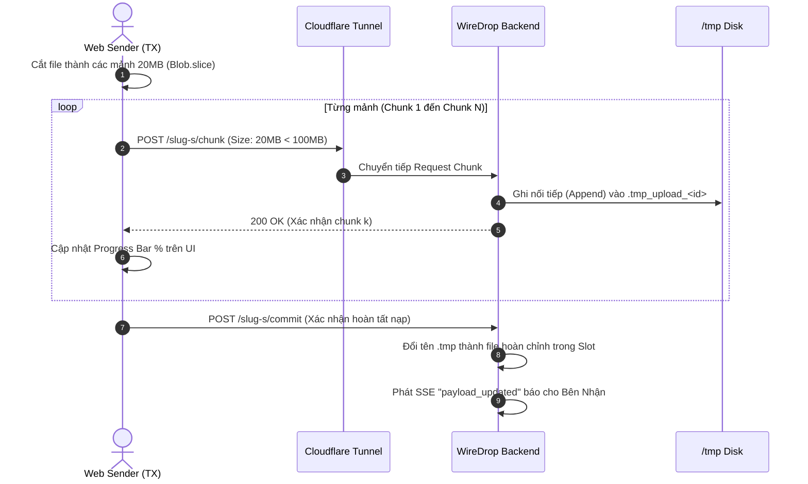
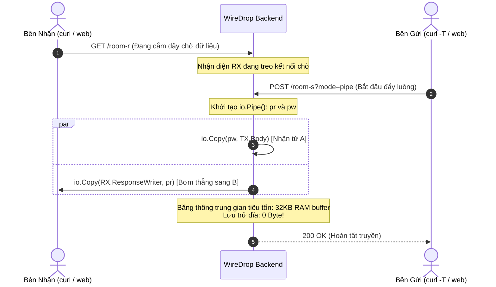

# ĐẶC TẢ KỸ THUẬT: TRUYỀN TẢI FILE DUNG LƯỢNG LỚN (LARGE FILE TRANSFER SPECIFICATION)
# HỆ THỐNG: WireDrop v4.1.0+

**Tác giả:** Đội ngũ Kỹ sư WireDrop  
**Trạng thái:** Bản Thảo Đề Xuất Kiến Trúc (Draft / Architectural RFC)  
**Ngày phát hành:** 2026-11-17  
**Phạm vi áp dụng:** Go Backend (`handler_pipe.go`, `room.go`), Web Client SPA (`app.js`, `index.html`, `style.css`), CLI Tooling (`curl`, `irm`, `fasthost`).

---

## 1. BỐI CẢNH & PHÂN TÍCH ĐIỂM NGHẼN (PROBLEM STATEMENT & BOTTLENECK AUDIT)

WireDrop hiện tại hoạt động theo mô hình **Single Atomic Slot** (khe cắm nguyên tử chứa 1 Text hoặc 1 File). Khi truyền file dung lượng lớn ($\ge 100\text{ MB}$ đến nhiều GB), hệ thống đối mặt với 5 điểm nghẽn vật lý và kiến trúc:

```
[BÊN GỬI (TX)]           [GATEWAY / TUNNEL]              [SERVER BACKEND]             [BÊN NHẬN (RX)]
  Web / CLI              Cloudflare Edge (Free)            Go Process & Disk           Terminal / Web
      │                          │                               │                          │
      │── 1. Thiếu Progress ───>│                               │                          │
      │   (UX treo đơ)           │                               │                          │
      │                          │── 2. Chặn cứng 100MB ────────>│                          │
      │                          │   (HTTP 413 Payload Too Large)│                          │
      │                          │                               │── 3. ParseMultipart ────>│
      │                          │                               │   (Ngốn RAM / 100MB max) │
      │                          │                               │                          │
      │                          │                               │── 4. Burn-After-Read ───>│
      │                          │                               │   (Xóa file khi tải dở)  │
```

### Chi tiết 5 điểm nghẽn:
1. **Nút thắt Gateway (Cloudflare Edge 100MB Limit):** Cloudflare Tunnel Free giới hạn cứng `HTTP Request Body <= 100MB`. Bất kỳ yêu cầu tải lên đơn khối (Single POST) vượt quá 100MB đều bị Cloudflare ngắt ngay tại Edge và trả về `413 Payload Too Large`.
2. **Nút thắt Bộ nhớ Backend (RAM Buffer Exhaustion):** Endpoint web hiện dùng `r.ParseMultipartForm(100MB)` kết hợp `io.ReadAll(file)` để nạp toàn bộ file vào RAM dưới dạng `[]byte`. Nhiều phòng tải file lớn đồng thời sẽ gây sập tiến trình Go do tràn RAM.
3. **Giới hạn cứng MaxBytesReader (150MB):** Dù tải qua CLI bằng header `X-Filename`, server vẫn giới hạn ở 150MB (`http.MaxBytesReader(w, r.Body, 150*1024*1024)`).
4. **Trải nghiệm Client thiếu phản hồi (No Upload Progress):** Web UI sử dụng `fetch()` với nhãn `[NẠP...]` tĩnh, không có tỷ lệ %, không có tốc độ MB/s, khiến người dùng nghĩ hệ thống bị treo.
5. **Rủi ro mất dữ liệu của cơ chế Tự hủy (Burn-After-Read):** File bị xóa khỏi server ngay thời điểm bắt đầu phục vụ (`os.Remove`). Nếu mạng của Bên Nhận rớt ở mức 95%, file biến mất hoàn toàn, không thể resume hay tải lại.

---

## 2. MA TRẬN CHIẾN LƯỢC TRUYỀN TẢI (TRANSFER TIER MATRIX)

Hệ thống phân tầng xử lý tự động dựa trên dung lượng file và sự hiện diện của hai đầu kết nối:

| Phân Loại | Kích Thước | Phương Thức Vận Chuyển | Nơi Lưu Trữ | Vượt Giới Hạn Cloudflare |
| :--- | :---: | :--- | :--- | :---: |
| **Tier 1: Siêu Nhỏ** | $< 15\text{ MB}$ | **In-Memory Store-and-Forward** | RAM (`[]byte`) | ✅ Tự nhiên |
| **Tier 2: Tiêu Chuẩn**| $15 - 90\text{ MB}$ | **Disk Store-and-Forward** | Ổ cứng tạm (`/tmp`) | ✅ Tự nhiên |
| **Tier 3A: Cắt Mảnh** | $90\text{ MB} - 10\text{ GB}$ | **Chunked Sliced Upload (20MB/chunk)** | Ghép file tạm trên ổ cứng | ✅ **Bypass 100MB Edge** |
| **Tier 3B: Bơm Trực Tiếp**| $100\text{ MB} - \infty$ | **Zero-Storage Pass-Through Pipe** | **0 Byte** (Socket $\rightarrow$ Socket qua `io.Pipe`) | ✅ Yêu cầu cắm 2 đầu đồng thời |

---

## 3. THIẾT KẾ CHI TIẾT CÁC CƠ CHẾ NÂNG CẤP

### 3.1. Cơ Chế 1: Chunked Sliced Upload (Vượt rào 100MB Cloudflare)

Áp dụng khi người dùng kéo thả file $> 90\text{ MB}$ vào Web UI hoặc khi script CLI gọi endpoint cắt mảnh.



#### Quy chuẩn Header Chunked:
- `X-Upload-Id`: UUID hoặc hash nhận diện phiên tải (tránh ghi đè khi nhiều file).
- `X-Chunk-Index`: Thứ tự mảnh bắt đầu từ `0`.
- `X-Total-Chunks`: Tổng số mảnh.
- `X-Chunk-Size`: Kích thước mảnh hiện tại (byte).
- `X-Total-Size`: Tổng dung lượng file gốc (byte).
- `X-Filename`: Tên file gốc (URL Encoded).

#### Xử lý an toàn phía Backend:
- Backend mở file tạm với cờ: `os.O_CREATE | os.O_WRONLY | os.O_APPEND`.
- Tự động kiểm tra `written == X-Total-Size` khi nhận cờ kết thúc.
- Quét định kỳ: Các file `.tmp_upload_*` không có hoạt động quá 30 phút sẽ tự động bị xóa dọn dẹp ổ cứng.

---

### 3.2. Cơ Chế 2: Zero-Storage Pass-Through Pipe (Khớp Nối Trực Tiếp Thời Gian Thực)

Áp dụng khi cả **Máy A và Máy B đều đang giữ dây online cùng lúc** và chọn chế độ truyền trực tiếp (`?mode=pipe` hoặc `live`):



#### Ưu điểm vượt trội:
- **Zero Disk Footprint:** Máy chủ hoàn toàn không ghi bất cứ byte nào vào ổ cứng SSD/HDD. Phù hợp tuyệt đối cho các máy chủ mini VPS (chỉ có 512MB RAM và 5GB SSD).
- **Không giới hạn dung lượng:** Có thể truyền file 50GB – 100GB mà không làm nghẽn server.

---

### 3.3. Cơ Chế 3: Safe Burn-After-Read & Hỗ Trợ Tải Tiếp (HTTP Range Resume)

Để loại bỏ rủi ro đứt mạng làm mất file, quy trình phục vụ file tại đầu nhận (`handleReceiver`) được chuẩn hóa lại:

#### A. Hỗ trợ Header `Range` (RFC 7233)
Server hỗ trợ chuẩn `Accept-Ranges: bytes` và xử lý header `Range: bytes=START-END`:
- Nếu client gửi `Range: bytes=1048576-` (yêu cầu tải từ byte thứ 1MB):
  - Server trả về mã `206 Partial Content`.
  - Header: `Content-Range: bytes 1048576-52428799/52428800`.
  - Nhảy con trỏ `f.Seek(1048576, io.SeekStart)` và stream phần còn lại.
  - Cho phép lệnh `curl -C - -sLJO http://.../slug-r` tiếp tục tải nốt nếu mạng bị gián đoạn.

#### B. Trì hoãn việc Tự Hủy (Delayed Destruction)
```go
// Chỉ xóa file SAU KHI io.Copy hoàn tất thành công 100%
written, err := io.Copy(w, f)
if err == nil && written == slot.FileSize {
    if room.BurnAfterRead {
        _ = os.Remove(slot.TempPath)
        room.ClearSlot()
        room.BroadcastSSE("payload_cleared", "")
    }
} else {
    log.Printf("[RX] Tải dở dang (%d/%d bytes). Giữ lại file để client resume.", written, slot.FileSize)
}
```

---

### 3.4. Cơ Chế 4: Nâng Cấp Web UI - Thanh Tiến Độ Retro Monochrome

Giao diện Web được nâng cấp đồng bộ theo phong cách Retro Minimalist:

1. **Hiển thị Upload Progress Bar:**
   - Thay thế `fetch` bằng `XMLHttpRequest` có hook `xhr.upload.onprogress`.
   - Tiến độ render dạng ký tự Monospace:
     ```text
     [████████████████░░░░░░░░] 64% • 12.4 MB/s • Còn 18s
     Đang nạp file: big-database-dump.sql (350 MB)
     ```
2. **Cảnh báo file vượt ngưỡng Cloudflare 100MB:**
   - Tự động hiển thị huy hiệu: `[CHẾ ĐỘ CẮT MẢNH TỰ ĐỘNG - CHUNKED 20MB]` khi file chọn $> 90\text{ MB}$.

---

## 4. KẾ HOẠCH TRIỂN KHAI THEO GIAI ĐOẠN (ROADMAP)

### Giai đoạn 1: Sửa Nút Thắt Cấp Bách (Quick Wins)
- [ ] Bỏ đọc toàn bộ file vào RAM trong `handler_pipe.go` (`io.ReadAll` $\rightarrow$ `os.CreateTemp` stream).
- [ ] Tích hợp Upload Progress Bar trực quan trên Web Client (`app.js`).
- [ ] Sửa lỗi Tự hủy: Chỉ xóa file khi `io.Copy` thành công trọn vẹn số byte.

### Giai đoạn 2: Vượt Giới Hạn Cloudflare (Chunked Upload)
- [ ] Bổ sung endpoint tiếp nhận mảnh: `POST /{room}-s/chunk` và `POST /{room}-s/commit`.
- [ ] Xây dựng module tự động cắt mảnh `Blob.slice(20MB)` trên frontend.
- [ ] Hỗ trợ lệnh CLI tương ứng (Script helper hoặc curl loop).

### Giai đoạn 3: Khớp Nối Trực Tiếp & Resume (Zero-Storage & Range)
- [ ] Hiện thực hóa `io.Pipe()` cho endpoint `?mode=pipe` khi cả 2 bên cùng online.
- [ ] Hỗ trợ `Accept-Ranges` và `206 Partial Content` phục vụ `curl -C -`.

---

## 5. KẾT LUẬN

Bản đặc tả này giải quyết triệt để nút thắt vật lý của Cloudflare Tunnel và kiến trúc lưu trữ của máy chủ, cho phép WireDrop vừa giữ nguyên triết lý **tinh gọn, 0 phụ thuộc, đơn giản 1-1**, vừa có khả năng truyền tải các tệp tin từ vài chục MB đến nhiều GB một cách mượt mà và an toàn.
