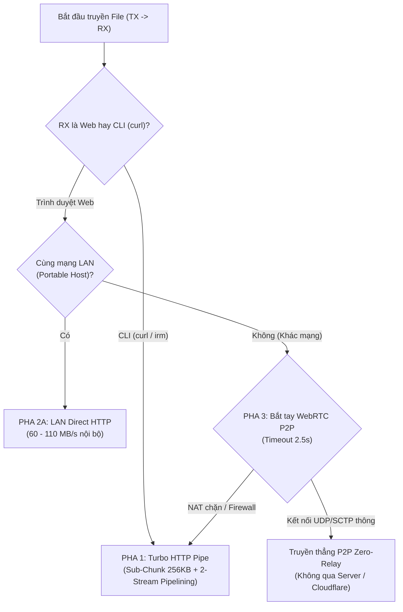

# ĐẶC TẢ KIẾN TRÚC: ĐỘNG CƠ TĂNG TỐC TRUYỀN FILE TURBO HTTP CORE
# (TURBO TRANSFER ENGINE SPECIFICATION - PHASE 1)
# HỆ THỐNG: WireDrop v0.7.0+

**Loại tài liệu:** `APPROVED ARCHITECTURAL SPECIFICATION` (Đặc Tả Kiến Trúc Đã Được Phê Duyệt)  
**Ngày phê duyệt:** 2026-11-18  
**Trạng thái:** 🚀 Đã triển khai Pha 1 (`v0.7.0`) / ⏳ **PENDING & ĐÓNG BĂNG** Pha 2 & Pha 3 (Theo Tuyên Bố Đóng Băng Phạm Vi Scope Freeze tại Spec 05)  
**Quyết định phê duyệt:** Chấp thuận toàn bộ 5/5 khuyến nghị thiết kế (Q1: Pha 1 Turbo HTTP Core cho v0.7.0; Q2: Vi mảnh 256KB với `sync.Pool`; Q3: Tối đa 2 luồng nạp song song gối đầu; Q4: Bậc mảnh theo dung lượng 8MB/16MB/32MB; Q5: Mặc định `--protocol http2` cho FastHost Tunnel).  
**Phiên bản áp dụng:** `v0.7.0`  
**Ràng buộc bất biến:** **100% Go Standard Library (Zero-Dependency)** • **0 Byte Ghi Đĩa Server** • **Giữ nguyên tương thích CLI (`curl`, `irm`)**

---

## MỤC LỤC
1. [Giải Phẫu Điểm Nghẽn Tốc Độ Hiện Tại (`v0.6.2`)](#1-giải-phẫu-điểm-nghẽn-tốc-độ-hiện-tại-v062)
2. [Kiến Trúc Đề Xuất Theo 3 Pha Độc Lập](#2-kiến-trúc-đề-xuất-theo-3-pha-độc-lập)
   - [Pha 1 (`v0.7.0`): Turbo HTTP Core (Sub-Chunk 256KB + Parallel Pipelining + Tunnel Tuning)](#21-pha-1-v070--turbo-http-core-tăng-tốc-toàn-diện-mọi-kênh-web--cli)
   - [Pha 2 (`v0.7.x`): Smart Payload & LAN Direct Bypass](#22-pha-2-v07x--smart-payload--lan-direct-bypass)
   - [Pha 3 (`v0.8.0`): Hybrid WebRTC P2P Zero-Relay](#23-pha-3-v080--hybrid-webrtc-p2p-zero-relay-truyền-thẳng-giữa-2-máy)
3. [Phân Tích Sâu Các Ca Khó & Chống Hỏng File (Critical Edge Cases)](#3-phân-tích-sâu-các-ca-khó--chống-hỏng-file-critical-edge-cases)
4. [Thiết Kế Dự Thảo Cấu Trúc Dữ Liệu & Giao Thức](#4-thiết-kế-dự-thảo-cấu-trúc-dữ-liệu--giao-thức)
5. [Bảng 5 Quyết Định Cần Chốt Trước Khi Khóa Spec Chính Thức](#5-bảng-5-quyết-định-cần-chốt-trước-khi-khóa-spec-chính-thức)

---

## 1. GIẢI PHẪU ĐIỂM NGHẼN TỐC ĐỘ HIỆN TẠI (`v0.6.2`)

Trong kiến trúc `v0.6.2`, dữ liệu đi từ Máy Gửi (TX) sang Máy Nhận (RX) theo chu trình sau:

```text
[Ổ cứng TX] ──(1. XHR tuần tự từng 16MB)──> [Cloudflare / Internet] ──(2. io.ReadAll gom đủ 16MB)──> [RAM Server] ──(3. w.Write 16MB)──> [Máy Nhận RX]
```

Qua phân tích kỹ thuật, có **4 nút cổ chai (bottlenecks)** đang kìm hãm tốc độ tối đa:

| STT | Điểm nghẽn (Bottleneck) | Cơ chế gây chậm trong code hiện tại | Tác động thực tế |
| :-: | :--- | :--- | :--- |
| **B1** | **Trễ gom nguyên khối 16MB (`Store-and-Forward per Chunk`) & Áp lực GC** | `handleChunkUpload` gọi `io.ReadAll(r.Body)`: Server phải đợi nhận **đủ 100% của 16MB** mới đẩy chunk vào kênh để xả sang RX. Đồng thời `io.ReadAll` tự cấp phát và nhân đôi mảng động ~15 lần cho mỗi chunk. | • Mạng upload 2 MB/s khiến RX phải đứng chờ **8 giây ở 0%** mới nhận được byte đầu tiên.<br>• Tốn thêm CPU copy bộ nhớ và kích hoạt Go Garbage Collector liên tục. |
| **B2** | **Nạp tuần tự Dừng-và-Đợi (`Stop-and-Wait XHR`)** | `app.js` đẩy xong Chunk $k$, chờ nhận HTTP `200 OK` về tới trình duyệt rồi mới khởi tạo kết nối gửi Chunk $k+1$. Chỉ dùng duy nhất 1 luồng TCP. | • Bị hụt băng thông ở các khoảng nghỉ RTT (50–150ms) giữa hai mảnh.<br>• Đơn luồng TCP không lấp đầy được băng thông đường truyền xa (WAN / xuyên quốc gia). |
| **B3** | **Bóp băng thông UDP/QUIC trên Cloudflare Tunnel** | Công cụ `cloudflared` trong `host.go` mặc định ưu tiên giao thức QUIC (chạy trên nền UDP). | • Nhiều nhà mạng tại Việt Nam giới hạn băng thông UDP quốc tế giờ cao điểm, làm tốc độ qua Tunnel tụt xuống 1–3 MB/s dù mạng gốc rất mạnh. |
| **B4** | **Đường truyền kẹp tóc 2 chặng (`Hairpin Relay`)** | Dữ liệu luôn phải vòng lên Server / Cloudflare Edge (Singapore/HongKong) rồi mới quay ngược về máy nhận. | • Hai máy đặt cạnh nhau chung Wi-Fi văn phòng lẽ ra đạt **80–100 MB/s** nhưng đi vòng qua Internet bị kìm xuống còn **4–10 MB/s**. |

---

## 2. KIẾN TRÚC ĐỀ XUẤT THEO 3 PHA ĐỘC LẬP

Để kiểm soát rủi ro chặt chẽ và bàn giao giá trị tăng tốc ngay từ sớm, kế hoạch được chia làm **3 Pha độc lập** (Pha sau kế thừa trọn vẹn Pha trước làm lưới bảo hiểm Fallback):



---

### 2.1. Pha 1 (`v0.7.0`) – Turbo HTTP Core (Tăng tốc toàn diện mọi kênh Web & CLI)

> **Mục tiêu:** Tăng tốc từ **40% – 200%**, giảm độ trễ byte đầu tiên (TTFB) xuống **`< 30ms`**, giảm RAM Server từ `32MB` xuống **`4MB – 8MB`**, giữ **100% tương thích ngược với `curl -sLJO`**.

#### Hạng mục 1.1: Luồng Vi Mảnh Xuyên Thấu (`256KB Sub-Chunk Streaming` + `sync.Pool`)
* **Bên ngoài (Client $\rightarrow$ Server):** Trình duyệt TX vẫn cắt file thành các HTTP POST `16MB` (hoặc `32MB`) để đi lọt hoàn toàn giới hạn 100MB của Cloudflare Proxy.
* **Bên trong (Server Engine):** Loại bỏ hoàn toàn `io.ReadAll(r.Body)`. Thay vào đó, `handleChunkUpload` mượn các khối đệm cố định **`256 KB`** từ `sync.Pool`, đọc từng nhát `256 KB` ngay khi gói tin vừa chạm card mạng Server và đẩy lập tức sang hàng đợi xả của `handleReceiver`.
* **Lợi ích kép:**
  1. **Zero-Wait TTFB:** Ngay mili-giây thứ 20 khi TX mới tải lên được `256 KB` đầu tiên (1.5% của mảnh 1), máy RX đã bắt đầu ghi dữ liệu xuống đĩa cứng! Upload và Download chạy song song 100% thời gian.
  2. **Zero-GC Churn:** Toàn bộ server dùng chung một bể `sync.Pool` các mảng `[262144]byte`, không cấp phát rác cho bộ dọn bộ nhớ Go.

#### Hạng mục 1.2: Nạp Gối Đầu 2 Luồng (`Dual-Stream Chunk Pipelining`)
* Thay vì đợi Mảnh $k$ gửi xong 100% mới gửi Mảnh $k+1$, khi RX đã vào dây (`rx_online == true`), trình duyệt TX duy trì **2 luồng XHR chạy gối đầu (`CONCURRENCY = 2`)**:
  * Luồng 1 đang bơm Mảnh $k$ (chảy thẳng sang RX theo từng khung `256KB`).
  * Luồng 2 đồng thời mở kết nối sẵn và nạp gối đầu Mảnh $k+1$ vào vùng đệm chờ kế tiếp trên Server.
* Ngay khoảnh khắc byte cuối cùng của Mảnh $k$ rời khỏi Server, Mảnh $k+1$ đã nằm chờ sẵn sàng ở đầu vòi — **triệt tiêu 100% thời gian nghỉ RTT giữa các mảnh**.

#### Hạng mục 1.3: Kích Thước Mảnh Thích Ứng (`Adaptive Chunk Size`) & Tối Ưu Giao Thức Tunnel
* **Adaptive Chunking trên TX:**
  * Khởi đầu Mảnh 0 cố định ở **`16 MB`** (để phản hồi nhanh & giữ nhẹ RAM nếu RX chưa mở trang).
  * Từ Mảnh 1 trở đi, đo tốc độ thực tế:
    * Nếu tốc độ $< 5\text{ MB/s}$ $\rightarrow$ Hạ mảnh xuống **`8 MB`** (tránh nguy cơ đứt kết nối giữa chừng hoặc chạm trần timeout 45s).
    * Nếu tốc độ $5 - 25\text{ MB/s}$ $\rightarrow$ Giữ chuẩn **`16 MB`**.
    * Nếu tốc độ $> 25\text{ MB/s}$ $\rightarrow$ Tự động nâng mảnh lên **`32 MB`** (hoặc **`64 MB`** trên mạng cực nhanh, vẫn thấp hơn an toàn so với giới hạn 100MB của Cloudflare) để giảm một nửa chi phí đóng/mở HTTP request.
* **Tinh chỉnh `cloudflared` trong `host.go` & `fasthost`:**
  * Thêm biến cấu hình `TUNNEL_PROTOCOL` trong `.env` (mặc định ưu tiên `http2` thay vì `auto/quic` thường bị bóp UDP tại Việt Nam, cho phép đổi lại `quic` nếu muốn).

---

### 2.2. Pha 2 (`v0.7.x`) – Smart Payload & LAN Direct Bypass

#### Hạng mục 2.1: Khám Phá Đường Tắt Nội Bộ (`LAN Direct Discovery` cho FastHost / Portable)
* Khi người dùng chạy `wiredrop-portable.exe` (hoặc `fasthost`), bản thân máy TX đang mở cổng nội bộ (ví dụ `192.168.1.15:8080`).
* Server tự quét các card mạng vật lý nội bộ (loại bỏ IP ảo Docker/WSL/Loopback) và gửi kèm danh sách `lan_urls` qua gói tin `init` của SSE.
* **Giải quyết bài toán bảo mật Mixed Content của Chrome/Edge:**
  * Nếu trang RX đang mở bằng `https://xxx.trycloudflare.com/abc-r`, trình duyệt sẽ chặn gọi ngầm `fetch("http://192.168.1.15:8080")` do chính sách *HTTPS $\rightarrow$ HTTP Mixed Content*.
  * **Cách xử lý chuẩn:** Dùng kỹ thuật `Image/Link Ping` hoặc hiển thị thanh thông báo nhỏ gọn trên đầu RX:  
    `[⚡ GỢI Ý MẠNG NỘI BỘ: Chuyển sang 192.168.1.15:8080 để tải tốc độ LAN 100 MB/s]`. Chỉ 1 cú click chuyển thẳng tab sang HTTP LAN, bỏ qua hoàn toàn Internet và Cloudflare!

#### Hạng mục 2.2: Nén Luồng Phần Cứng Tự Động (`Smart Native CompressionStream`)
* Tận dụng API chuẩn W3C `CompressionStream("gzip")` và `DecompressionStream("gzip")` tích hợp sẵn bằng C++ trong mọi trình duyệt hiện đại (Chrome 80+, Edge 80+, Firefox 113+, Safari 16.4+ — **0KB thư viện ngoài**).
* **Bộ lọc thông minh theo phần mở rộng (Zero-Waste CPU):**
  * **CHỈ NÉN** khi file thuộc nhóm văn bản / dữ liệu thô có tỷ lệ nén cao: `.txt`, `.log`, `.csv`, `.tsv`, `.json`, `.sql`, `.xml`, `.yaml`, `.yml`, `.html`, `.css`, `.js`, `.ts`, `.go`, `.py`, `.tar`, `.bmp`, `.wav`, `.svg`.
  * **BỎ QUA 100%** với mọi file đã nén sẵn (`.zip`, `.7z`, `.rar`, `.gz`, `.mp4`, `.mkv`, `.mp3`, `.jpg`, `.png`, `.webp`, `.pdf`, `.docx`, `.exe`, `.iso`).
* **Xử lý tương thích với `curl` CLI:**
  * Nếu nén ở tầng nội dung (`X-Content-Compressed: gzip`): Web RX tự động giải nén trong luồng ghi đĩa; còn nếu RX tải bằng `curl`, để tránh việc `curl -sLJO` lưu ra file `.sql` nhưng bên trong bị nén gzip nếu thiếu cờ `--compressed`, **chế độ nén tự động mặc định chỉ kích hoạt khi phát hiện RX đang kết nối bằng Trình duyệt Web** (hoặc khi người dùng bật công tắc `[✓ NÉN NHANH]`).

---

### 2.3. Pha 3 (`v0.8.0`) – Hybrid WebRTC P2P Zero-Relay (Truyền Thẳng Giữa 2 Máy)

> **Đột phá lớn nhất cho Web-to-Web:** Biến WireDrop thành công cụ truyền trực tiếp ngang hàng (tương tự AirDrop / PairDrop) nhưng vượt trội hơn ở chỗ **có sẵn đường ống Turbo HTTP làm phao cứu sinh 100%** khi mạng chặn P2P hoặc khi đầu nhận là Terminal!

* **Kiến trúc Không Phụ Thuộc (Zero-Dependency Signaling):**
  * Server Go **không cần cài đặt thư viện WebRTC** (như Pion). Server chỉ thêm duy nhất 1 endpoint mỏng `POST /{room}/signal` (~30 dòng code Go) để chuyển tiếp nguyên vẹn gói JSON (`SDP Offer`, `SDP Answer`, `ICE Candidate`) qua luồng SSE 1-1 sẵn có giữa TX và RX!
* **Quy trình Bắt Tay Ngầm & Chuyển Mạch Mượt (`Seamless P2P Upgrade`):**
  1. Ngay khi cả TX và RX cùng mở trang Web (đèn báo `TX ●──RX ●`), hai trình duyệt tự động trao đổi ICE/SDP ngầm qua STUN công cộng (`stun:stun.l.google.com:19302`, `stun:stun.cloudflare.com:3478`).
  2. Nếu kết nối `RTCDataChannel` thông suốt: Header hiện huy hiệu `[TX ●══P2P══● RX]`.
  3. Khi TX thả file:
     * **Nếu kênh P2P đang mở:** Bắn trực tiếp các khung `64KB` qua `RTCDataChannel` (điều tiết áp lực ngược bằng sự kiện `bufferedamountlow`), ghi thẳng xuống ổ cứng RX qua `FileSystemWritableFileStream`. **0 byte đi qua Server, không giới hạn dung lượng, tốc độ kịch trần đường truyền vật lý (50 – 120 MB/s)!**
     * **Nếu P2P không thông (do tường lửa công ty / Symmetric NAT) hoặc RX dùng `curl`:** Tự động chạy qua **Turbo HTTP Pipe (Pha 1)** ngay lập tức mà người dùng không cần thao tác lại.

---

## 3. PHÂN TÍCH SÂU CÁC CA KHÓ & CHỐNG HỎNG FILE (CRITICAL EDGE CASES)

Đây là 3 bài toán kỹ thuật bắt buộc phải giải quyết triệt để trong thiết kế để đảm bảo **không bao giờ xảy ra lỗi hỏng file (corrupted binary) hay treo cứng (deadlock)**:

### 3.1. Ca Khó #1: Đứt Mạng Giữa Chừng Khi Đang Stream Vi Mảnh (`Mid-Chunk Retry Integrity`)
* **Tình huống nguy hiểm:** Giả sử với Sub-Chunk Streaming (Pha 1.1), Mảnh thứ 2 (`16MB`) mới chảy được `6 MB` qua Server xuống thẳng ổ cứng của RX thì mạng bên TX bị rớt gói tin làm đứt request POST.
* **Hệ quả nếu xử lý ngây thơ:** Nếu TX tự động retry gửi lại Mảnh 2 từ byte `0` và Server cứ thế ghi tiếp vào luồng của RX, máy RX sẽ bị ghi lặp `6 MB` đầu của Mảnh 2 $\rightarrow$ **File tải về bị lệch byte và hỏng hoàn toàn!**
* **Giải pháp kỹ thuật bắt buộc (`Exact Byte-Offset Resume`):**
  1. Trên `ChunkSession` của Server, duy trì bộ đếm nguyên tử `FlushedTotalBytes int64` (tổng số byte thực tế đã `w.Write()` thành công xuống socket RX).
  2. Khi TX gặp lỗi mạng và chuẩn bị retry Mảnh $k$, TX gửi kèm header truy vấn hoặc nhìn vào phản hồi lỗi / gọi nhẹ `GET /{slug}/events?check=1` để lấy `flushed_bytes` hiện tại của phiên, **HOẶC** đơn giản hơn nữa ở phía Server:
     * Mỗi byte trong toàn bộ file có vị trí tuyệt đối `GlobalOffset = chunkIndex * ChunkSize + localOffset`.
     * Nếu TX gửi lại Mảnh $k$ từ đầu, Server so sánh `GlobalOffset` với `sess.FlushedTotalBytes`: bất kỳ byte nào có `GlobalOffset < sess.FlushedTotalBytes` sẽ được Server tự động bỏ qua (`discard`), và chỉ bắt đầu `w.Write()` xuống RX đúng từ byte `sess.FlushedTotalBytes` trở đi!
  3. **Kết quả:** Kể cả rút dây mạng cắm lại giữa mảnh, file nhận được ở cả Web RX lẫn `curl` vẫn **khớp tuyệt đối 100% mã băm SHA-256 / CRC32**!

### 3.2. Ca Khó #2: Khóa Chết Bộ Đệm (`Out-of-Order Head-of-Line Deadlock`) Khi Nạp 2 Luồng Song Song
* **Tình huống nguy hiểm:** Khi TX mở 2 luồng song song gửi Mảnh $0$ và Mảnh $1$. Giả sử mạng định tuyến khiến Mảnh $1$ bay tới Server trước và lấp đầy toàn bộ bộ đệm RAM, khiến Mảnh $0$ không còn chỗ trống để vào, trong khi RX lại bắt buộc phải đọc Mảnh $0$ trước mới giải phóng bộ đệm $\rightarrow$ **Deadlock vĩnh viễn!**
* **Giải pháp kỹ thuật bắt buộc (`Dedicated Indexed Slot Ring`):**
  * Không dùng chung một hàng đợi vô hướng cho 2 luồng!
  * Thiết kế 2 khe độc lập theo chỉ số chẵn/lẻ (`Slot[chunkIndex % 2]`):
    * Luồng đang giữ `chunkIndex == CurrentReadingIndex` được **quyền chảy trực tiếp (Direct Stream)** qua kênh `256KB` sang RX.
    * Luồng giữ `chunkIndex == CurrentReadingIndex + 1` chỉ được phép nạp trước vào khe đệm dự phòng `PrefetchSlot` (tối đa `16MB` hoặc dừng chờ cổng `turnGate` mở khi mảnh trước hoàn tất).
  * Nhờ vậy, mảnh đi sau **không bao giờ** chiếm được đường ống của mảnh đi trước. Deadlock bằng **0%**.

### 3.3. Ca Khó #3: Kích Thước Mảnh Động (`Adaptive Chunk Size`) Làm Lệch Phép Tính Chỉ Mục
* **Tình huống nguy hiểm:** Nếu Mảnh 0 dài `16MB`, Mảnh 1 đổi sang dài `32MB`, công thức cũ `start = idx * CHUNK_SIZE` và `totalChunks` cố định sẽ tính sai vị trí byte và làm nhảy loạn lưới `.batch-grid` trên UI!
* **Giải pháp kỹ thuật bắt buộc:**
  * Thay vì đổi kích thước mảnh giữa chừng trong cùng 1 phiên, áp dụng **Pre-Flight / Per-File Chunk Sizing** hoặc gửi tường minh `X-Byte-Offset` trên mỗi request:
    * *Phương án sạch nhất:* Chọn kích thước mảnh tối ưu theo dung lượng file (ví dụ file $< 64\text{MB}$ dùng mảnh `8MB`; file $64\text{MB} - 512\text{MB}$ dùng mảnh `16MB`; file $> 512\text{MB}$ dùng mảnh `32MB`), kết hợp Sub-Chunk `256KB` bên trong. Vừa gọn nhẹ toán học, lưới `.batch-grid` cố định đẹp mắt, vừa đạt hiệu suất tối đa!

---

## 4. THIẾT KẾ DỰ THẢO CẤU TRÚC DỮ LIỆU & GIAO THỨC

### 4.1. Cấu trúc Bể Bộ Đệm Tái Sử Dụng (`sync.Pool` trong `room.go`)
```go
const (
    SubChunkSize = 256 * 1024 // 256KB mỗi vi khung truyền xuyên thấu
)

var subChunkPool = sync.Pool{
    New: func() any {
        buf := make([]byte, SubChunkSize)
        return &buf
    },
}

type SubChunkFrame struct {
    BufPtr *[]byte // Trả lại vào subChunkPool ngay sau khi w.Write() sang RX hoàn tất
    Len    int     // Số byte thực tế trong khung (<= 256KB)
    EOF    bool    // Đánh dấu kết thúc mảnh lớn
}
```

### 4.2. Các Header Mở Rộng (Tương thích ngược 100%)
```http
POST /{slug}-s/chunk?conn={cid} HTTP/1.1
X-Session-ID: sess_a1b2_...
X-File-Name: video%204k.mp4
X-File-Size: 1073741824
X-Chunk-Index: 2
X-Total-Chunks: 34
X-Byte-Offset: 67108864        <-- [MỚI] Vị trí byte tuyệt đối để chống lệch dữ liệu khi Retry
X-Content-Encoding: identity   <-- [MỚI - Pha 2] "gzip" nếu bật nén luồng tự động
```

---

## 5. BẢNG 5 QUYẾT ĐỊNH CẦN CHỐT TRƯỚC KHI KHÓA SPEC CHÍNH THỨC

Trước khi chuyển tài liệu này từ `SPEC-PREPARE` sang `APPROVED SPEC` và bắt tay vào lập trình, dưới đây là **5 điểm quyết định thiết kế** cùng phương án khuyến nghị để thống nhất:

| # | Câu hỏi Thiết kế | Phương án A (Khuyến nghị ⭐) | Phương án B (Thay thế) | Lý do Khuyến nghị |
| :-: | :--- | :--- | :--- | :--- |
| **Q1** | **Phạm vi triển khai ngay cho bản `v0.7.0` sắp tới?** | **Làm trọn vẹn Pha 1 (Turbo HTTP Core)** trước (`Sub-Chunk 256KB` + `2-Stream Pipelining` + `Tunnel HTTP/2`). Đạt độ ổn định tuyệt đối rồi mới sang Pha 2/3 ở `v0.8.0`. | Gộp làm cả Pha 1 + Pha 2 + Pha 3 (WebRTC P2P) trong một lần cập nhật lớn duy nhất. | Chia từng mốc giúp kiểm thử dễ dàng, giữ code sạch, và Pha 1 lập tức tăng tốc cho **cả Web lẫn `curl` CLI**. |
| **Q2** | **Kích thước Vi Mảnh (`Sub-Chunk`) chảy trong RAM Server?** | **`256 KB` / khung** (Hàng đợi tối đa 32 khung = `8 MB` RAM cho luồng trực tiếp + 1 khe gối đầu `16 MB` = tối đa `24 MB` RAM/phòng). | `64 KB` / khung hoặc `1 MB` / khung. | `256 KB` là điểm ngọt lý tưởng cho L2/L3 CPU Cache và TCP Send Buffer, giảm số vòng lặp syscall mà vẫn cho TTFB `< 25ms`. |
| **Q3** | **Số luồng tải lên song song (`TX Concurrency`) ở Pha 1.2?** | **Tối đa `2 luồng` song song** (1 luồng đang chảy trực tiếp sang RX + 1 luồng nạp gối đầu mảnh kế tiếp). | Mở `4 luồng` song song như IDM. | Với triết lý Zero-Disk (không lưu file tạm ra ổ cứng server), `2 luồng` giữ trần RAM dưới `32 MB` đúng cam kết kiến trúc mà vẫn xóa sạch 100% thời gian chết RTT. |
| **Q4** | **Chiến lược Kích thước Mảnh (`Chunk Size`) theo dung lượng file?** | **Theo bậc cố định đầu phiên:** File $\le 64\text{MB} \rightarrow 8\text{MB}$/mảnh; File $\le 512\text{MB} \rightarrow 16\text{MB}$/mảnh; File $> 512\text{MB} \rightarrow 32\text{MB}$/mảnh. | Cố định cứng `16 MB` cho mọi kích thước file như hiện tại. | File 1GB–4GB dùng mảnh `32MB` giảm một nửa số request HTTP và số chip trên giao diện, vẫn thấp hơn 3 lần trần 100MB của Cloudflare. |
| **Q5** | **Giao thức mặc định của Cloudflare Tunnel trong `host.go`?** | Mặc định thêm cờ **`--protocol http2`** (cho phép ghi đè bằng `TUNNEL_PROTOCOL=quic` hoặc `auto` trong `.env`). | Giữ nguyên mặc định `auto` (ưu tiên QUIC/UDP) của `cloudflared`. | Thực tế hạ tầng mạng tại Việt Nam chạy `http2` (TCP) cho băng thông truyền file lớn ổn định và cao hơn hẳn UDP/QUIC. |
