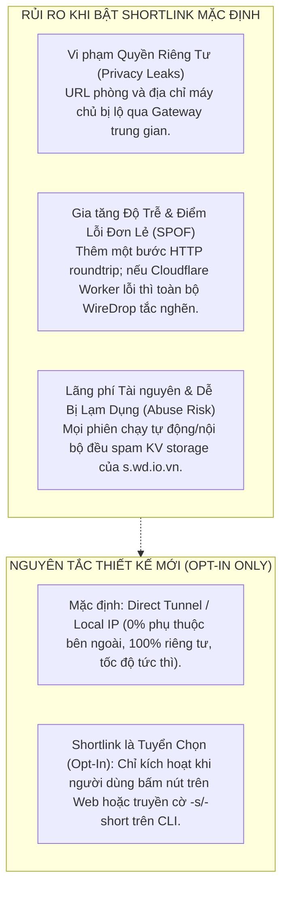
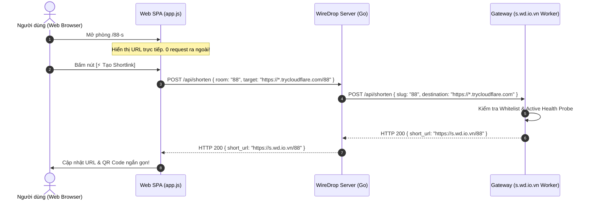
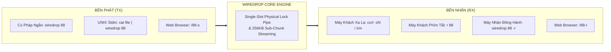

# ĐẶC TẢ KIẾN TRÚC: TERMINAL NATIVE PIPE, ĐƠN GIẢN HÓA CÚ PHÁP & CƠ CHẾ RÚT GỌN LINK TUYỂN CHỌN
# (ULTRA-SIMPLIFIED TERMINAL PIPE & SELECTIVE SHORTLINK SPECIFICATION)
# HỆ THỐNG: WireDrop v0.8.0-dev / v0.7.3+

**Loại tài liệu:** `📝 SPEC-PREPARE` (Tài Liệu Chuẩn Bị Đặc Tả Kiến Trúc & RFC)  
**Ngày khởi tạo:** 2026-11-19 (Cập nhật phiên bản tinh giản cú pháp)  
**Trạng thái:** Chờ Thẩm Định & Phê Duyệt Quyết Định (Pending Review & Approval)  
**Tác giả:** Đội ngũ Kiến trúc WireDrop  
**Ràng buộc bất biến:**  
* **100% Go Standard Library (Zero-Dependency)** — Tuyệt đối không thêm thư viện ngoài.  
* **0 Byte Ghi Đĩa Server** — Toàn bộ dòng dữ liệu (text/file) đi qua RAM Streaming hoặc Ping-Pong Buffering.  
* **Máy Nhận Tuyệt Đối Không Bị Ép Cài Đặt (Zero-Install Machine B)** — Máy khách xa lạ luôn có thể nhận bằng công cụ mặc định của hệ điều hành (`curl`, `irm`, trình duyệt web).  
* **Cú pháp gõ tối giản cực hạn (Ultra-Simplified Typing)** — Bỏ qua từ khóa rườm rà, hỗ trợ gõ thẳng mã phòng `wiredrop <room>`.  
* **Shortlink là Opt-in (0% Phụ thuộc ngầm)** — Mặc định chạy Direct Tunnel/Local IP, không phát sinh bất kỳ request nào ra ngoài gateway nếu người dùng không yêu cầu.

---

## MỤC LỤC
1. [Bối Cảnh & Động Lực Thiết Kế (Motivation & Problem Statement)](#1-bối-cảnh--động-lực-thiết-kế-motivation--problem-statement)
   - [1.1. Bản chất của Shortlink: Tiện ích bổ trợ, Tuyệt đối không phải luồng mặc định](#11-bản-chất-của-shortlink-tiện-ích-bổ-trợ-tuyệt-đối-không-phải-luồng-mặc-định)
   - [1.2. Giải phẫu nghịch lý: Máy khách xa lạ nhận bằng gì?](#12-giải-phẫu-nghịch-lý-máy-khách-xa-lạ-nhận-bằng-gì)
   - [1.3. Triết lý tinh giản cú pháp: Gõ ít nhất, hiệu quả cao nhất](#13-triết-lý-tinh-giản-cú-pháp-gõ-ít-nhất-hiệu-quả-cao-nhất)
2. [Kiến Trúc Luồng Rút Gọn Link Tuyển Chọn (Selective Shortlink Architecture)](#2-kiến-trúc-luồng-rút-gọn-link-tuyển-chọn-selective-shortlink-architecture)
   - [2.1. Ma trận chọn lọc trên FastHost Console & CLI](#21-ma-trận-chọn-lọc-trên-fasthost-console--cli)
   - [2.2. Ma trận chọn lọc trên Web UI (On-Demand Shorten Button)](#22-ma-trận-chọn-lọc-trên-web-ui-on-demand-shorten-button)
   - [2.3. Mô hình phòng vệ chống lạm dụng Gateway `s.wd.io.vn`](#23-mô-hình-phòng-vệ-chống-lạm-dụng-gateway-swdiovn)
3. [Đặc Tả Sợi Dây Terminal Trực Tiếp & Đơn Giản Hóa Cú Pháp CLI](#3-đặc-tả-sợi-dây-terminal-trực-tiếp--đơn-giản-hóa-cú-pháp-cli)
   - [3.1. Cú pháp gõ siêu ngắn (Zero-Subcommand Shorthand)](#31-cú-pháp-gõ-siêu-ngắn-zero-subcommand-shorthand)
   - [3.2. Bảng đối chiếu các dạng cú pháp hỗ trợ](#32-bảng-đối-chiếu-các-dạng-cú-pháp-hỗ-trợ)
   - [3.3. Cơ chế phục vụ Máy Khách Xa Lạ (Zero-Install Foreign Client Receiver)](#33-cơ-chế-phục-vụ-máy-khách-xa-lạ-zero-install-foreign-client-receiver)
   - [3.4. Vũ khí phím tắt 1 chữ cái `r` trên Máy Khách Xa Lạ (`/i` và `/i.ps1`)](#34-vũ-khí-phím-tắt-1-chữ-cái-r-trên-máy-khách-xa-lạ-i-và-ips1)
   - [3.5. Chế độ Đầu Phát Tương Tác (TX Interactive REPL Mode)](#35-chế-độ-đầu-phát-tương-tác-tx-interactive-repl-mode)
   - [3.6. Chế độ Đầu Nhận Đồng Hành (RX Companion Mode)](#36-chế-độ-đầu-nhận-đồng-hành-rx-companion-mode)
   - [3.7. Đường Ống UNIX Tự Động Nhận Diện (Zero-Flag UNIX Piping)](#37-đường-ống-unix-tự-động-nhận-diện-zero-flag-unix-piping)
   - [3.8. Chế độ Mở Trình Duyệt Web (`--web` / `-w`)](#38-chế-độ-mở-trình-duyệt-web---web---w)
4. [Đặc Tả Giao Thức Mạng & Mô Hình Tương Tác Chéo (Interoperability Matrix)](#4-đặc-tả-giao-thức-mạng--mô-hình-tương-tác-chéo-interoperability-matrix)
5. [Cấu Trúc Dữ Liệu & Bản Vẽ Kỹ Thuật (Data Structures & Technical Blueprint)](#5-cấu-trúc-dữ-liệu--bản-vẽ-kỹ-thuật-data-structures--technical-blueprint)
6. [Bảng Quyết Định Cần Phê Duyệt (Decision Matrix)](#6-bảng-quyết-định-cần-phê-duyệt-decision-matrix)

---

## 1. BỐI CẢNH & ĐỘNG LỰC THIẾT KẾ (MOTIVATION & PROBLEM STATEMENT)

### 1.1. Bản chất của Shortlink: Tiện ích bổ trợ, Tuyệt đối không phải luồng mặc định

Trong phiên bản `v0.7.2`, hệ thống đã tích hợp Cloudflare Worker Gateway cho tên miền `s.wd.io.vn` nhằm giải quyết vấn đề URL ngẫu nhiên của Cloudflare Quick Tunnel (`*.trycloudflare.com`) quá dài để gõ tay trên điện thoại di động.

Tuy nhiên, qua thẩm định kiến trúc sâu sắc, **Shortlink không thể và không bao giờ được phép là luồng hoạt động mặc định**. Việc biến shortlink thành mặc định vi phạm 3 nguyên lý nền tảng của WireDrop:



* **Kết luận định hướng:** Shortlink là một **tiện ích bổ trợ cực kỳ giá trị**, nhưng phải được kiểm soát chủ động bởi người dùng thông qua các giao diện tường minh (Explicit Flow).

---

### 1.2. Giải phẫu nghịch lý: Máy khách xa lạ nhận bằng gì?

Trong thảo luận kỹ thuật, một nghịch lý lớn đã được mổ xẻ:
> *"Nếu người gửi gõ `wiredrop open debug-room`, làm sao người nhận là một **máy khách xa lạ** (chưa từng biết đến WireDrop, chưa hề cài đặt binary `wiredrop`) có thể gõ `wiredrop open debug-room -r` để nhận?!"*

Đây là sự thật hiển nhiên: **Một máy khách xa lạ không có binary `wiredrop`!**
Nếu bắt buộc máy khách xa lạ phải tìm cách tải `wiredrop` về máy rồi mới được nhận dữ liệu, thì WireDrop đã biến thành một bản sao thất bại của Croc hay Magic-Wormhole (vốn bị người dùng tẩy chay khi chạy trên server tối giản hoặc máy khách bị hạn chế quyền IT).

**Nguyên lý phân tầng WireDrop:**
1. **Bên Phát (Sender TX):** Là người chủ động truyền tin, sở hữu công cụ WireDrop binary (hoặc dùng Web TX).
2. **Bên Nhận Đồng Hành (Companion RX):** Là máy thứ hai của chính kỹ sư đó hoặc đồng đội cùng team đã có binary $\rightarrow$ Được quyền dùng lệnh terminal nâng cao `wiredrop open <room> -r`.
3. **Máy Khách Xa Lạ (Zero-Install Foreign Client RX):** Tuyệt đối **không cần và không thể gõ lệnh `wiredrop`**. Họ nhận trực tiếp bằng các công cụ nguyên bản có sẵn từ lúc cài đặt hệ điều hành:
   * Linux/macOS: `curl -sN ...` hoặc `curl -sL ... | sh` hoặc `curl -sLJO ...`
   * Windows: `irm ... | iex` hoặc `curl.exe -sLJO ...`
   * Mobile / Web: Mở trực tiếp link ngắn trên trình duyệt Safari/Chrome.

---

### 1.3. Triết lý tinh giản cú pháp: Gõ ít nhất, hiệu quả cao nhất

Các công cụ CLI kinh điển thường bắt người dùng gõ những câu lệnh dài dòng: `wiredrop open --room my-room --role sender --interactive`. Điều này tạo ra rào cản gõ phím.

**Mục tiêu thiết kế mới:**
* **Bỏ hoàn toàn từ khóa rườm rà:** Người dùng chỉ cần gõ tên công cụ kèm mã phòng: `wiredrop 88`.
* **Tự động suy luận ngữ cảnh:**
  * Có pipe dữ liệu vào (`cat file | wiredrop 88`) $\rightarrow$ Tự động chuyển thành Stream Sender, tắt toàn bộ banner.
  * Có cờ `-r` (`wiredrop 88 -r`) $\rightarrow$ Tự động chuyển thành Receiver.
  * Có pipe ra (`wiredrop 88 -r | bash`) $\rightarrow$ Tự động chuyển thành Raw Stream, không in ký tự điều khiển ANSI.

---

## 2. KIẾN TRÚC LUỒNG RÚT GỌN LINK TUYỂN CHỌN (SELECTIVE SHORTLINK ARCHITECTURE)

### 2.1. Ma trận chọn lọc trên FastHost Console & CLI

Khi khởi động FastHost qua binary (`wiredrop-portable.exe` hoặc `wiredrop host`), menu tương tác được thiết kế lại nhằm tôn trọng nguyên tắc **Direct First**:

```text
================================================================
     ⚡ WIREDROP FASTHOST PORTABLE - SELECTION MENU            
================================================================
 [1] Quick Tunnel Trực Tiếp (Mặc định - Nhanh nhất, Không trung gian)
 [2] Quick Tunnel + Rút gọn Shortlink (s.wd.io.vn - Dễ gõ Mobile)
 [3] Domain cá nhân cố định (Named Tunnel Token)
 [4] Chỉ chạy mạng nội bộ (Local Only - 100% Offline)
 [0] Thoát
----------------------------------------------------------------
Lựa chọn của bạn [1/2/3/4/0] (Mặc định: 1): _
```

#### Bảng Tùy Chọn CLI Flags:
| Lệnh / Cờ CLI | Ý nghĩa | Hành vi mạng của Gateway `s.wd.io.vn` |
| :--- | :--- | :--- |
| `wiredrop host` | Khởi động FastHost mặc định | **Không gọi gateway**. Xuất URL `https://*.trycloudflare.com` trực tiếp. |
| `wiredrop host -short` (hoặc `-s`) | Khởi động FastHost kèm rút gọn link | Gửi POST tới `s.wd.io.vn/api/shorten`, in ra link ngắn `https://s.wd.io.vn/<slug>`. |
| `wiredrop host -room <id> [-s]` | Khởi động với phòng cố định | Tự tạo phòng theo mã `<id>`, tùy chọn rút gọn nếu có cờ `-s`. |
| `wiredrop host -port <p>` | Đổi cổng lắng nghe | Lắng nghe trên cổng chỉ định (mặc định 8080). |

---

### 2.2. Ma trận chọn lọc trên Web UI (On-Demand Shorten Button)

Trên giao diện Web (`public/index.html` và `public/app.js`):
1. **Trạng thái ban đầu:** Ô hiển thị URL chỉ chứa link phòng trực tiếp (ví dụ: `https://abcd-1234.trycloudflare.com/88-s`). Mã QR Code sinh trực tiếp từ URL này. Tuyệt đối không gửi request nào ra ngoài.
2. **Nút On-Demand `[⚡ Tạo Shortlink]`:**
   * Nằm cạnh nút `Sao chép Link`.
   * Khi người dùng nhấp vào nút này:
     * Frontend gọi API `POST /api/shorten` trên WireDrop Server nội bộ (hoặc gọi trực tiếp Cloudflare Worker Gateway nếu cấu hình).
     * Trạng thái nút chuyển thành spinner: `Đang tạo...`.
     * Khi thành công: Ô URL đổi thành `https://s.wd.io.vn/88-s` (hoặc `88-r`), QR Code vẽ lại theo link ngắn, và nút chuyển thành `Đã rút gọn`.
     * Nếu mạng lỗi hoặc Gateway không khả dụng: Giữ nguyên link gốc và hiển thị thông báo nhẹ (Toast notification): `Không thể tạo shortlink, giữ nguyên link gốc`.



---

### 2.3. Mô hình phòng vệ chống lạm dụng Gateway `s.wd.io.vn`

Để đảm bảo tên miền cá nhân `s.wd.io.vn` không bị lợi dụng làm bàn đạp phát tán mã độc (phishing/malware), kiến trúc Cloudflare Worker duy trì cơ chế phòng vệ 4 lớp nghiêm ngặt:

```
[Request Tạo Shortlink]
         │
         ▼
 ┌────────────────────────────────────────────────────────┐
 │ Lớp 1: Destination Whitelist Regex                      │
 │ Chỉ cho phép đích đến là *.trycloudflare.com           │
 └───────────────────────┬────────────────────────────────┘
                         ▼ (Hợp lệ)
 ┌────────────────────────────────────────────────────────┐
 │ Lớp 2: Active Health Probe                             │
 │ Worker chủ động gọi GET {destination}/health           │
 │ Bắt buộc phản hồi HTTP 200 trong vòng 2 giây           │
 └───────────────────────┬────────────────────────────────┘
                         ▼ (Pass Probe)
 ┌────────────────────────────────────────────────────────┐
 │ Lớp 3: Giới Hạn Tần Suất (IP Rate Limit) & Dung Lượng   │
 │ Tối đa 20 request / 10 phút trên mỗi IP                │
 │ Body JSON giới hạn < 2 KB                              │
 └───────────────────────┬────────────────────────────────┘
                         ▼ (Hợp lệ)
 ┌────────────────────────────────────────────────────────┐
 │ Lớp 4: Ephemeral Auto-Destruction (TTL Tự Hủy)          │
 │ Lưu trữ Cloudflare KV tự hủy sau 30 phút (TTL = 1800s) │
 └────────────────────────────────────────────────────────┘
```

---

## 3. ĐẶC TẢ SỢI DÂY TERMINAL TRỰC TIẾP & ĐƠN GIẢN HÓA CÚ PHÁP CLI

### 3.1. Cú pháp gõ siêu ngắn (Zero-Subcommand Shorthand)

Hệ thống cho phép gõ trực tiếp mã phòng ngay sau lệnh nhị phân:

```bash
# 1. Mở phòng phát (TX) - Siêu ngắn (không cần gõ chữ 'open')
wiredrop 88

# 2. Mở phòng phát kèm Shortlink s.wd.io.vn
wiredrop 88 -s

# 3. Mở phòng nhận (RX) - Nếu máy nhận cũng có binary
wiredrop 88 -r

# 4. Mở phòng bằng trình duyệt Web
wiredrop 88 -w
```

---

### 3.2. Bảng đối chiếu các dạng cú pháp hỗ trợ

Để đảm bảo vừa tiện lợi tối đa cho người thích gõ ngắn, vừa tự nhiên cho người quen gõ lệnh tường minh:

| Nhu cầu sử dụng | Cú pháp siêu ngắn (Khuyên dùng) | Cú pháp tường minh tương đương |
| :--- | :--- | :--- |
| **Mở phòng phát (TX Terminal REPL)** | `wiredrop 88` | `wiredrop open 88` hoặc `wiredrop send 88` hoặc `wiredrop s 88` |
| **Mở phòng phát kèm Shortlink** | `wiredrop 88 -s` | `wiredrop open 88 -short` |
| **Mở phòng nhận (RX Terminal)** | `wiredrop 88 -r` | `wiredrop open 88 --rx` hoặc `wiredrop recv 88` hoặc `wiredrop r 88` |
| **Mở phòng trên Trình duyệt Web** | `wiredrop 88 -w` | `wiredrop open 88 --web` |
| **Pipe Stdin vào phòng** | `cat file \| wiredrop 88` | `cat file \| wiredrop open 88` |
| **Pipe Stdout phòng vào Bash** | `wiredrop 88 -r \| bash` | `wiredrop open 88 -r -q \| bash` |

---

### 3.3. Cơ chế phục vụ Máy Khách Xa Lạ (Zero-Install Foreign Client Receiver)

Khi người phát thực thi `wiredrop 88`, terminal của người phát **ngay lập tức hiển thị một Cheat Sheet các câu lệnh sẵn sàng copy để gửi cho máy khách xa lạ**:

```text
================================================================
  ⚡ WIREDROP PIPE: 88 [ĐẦU PHÁT TX ĐÃ SẴN SÀNG]
================================================================
  Gửi 1 trong các câu lệnh dưới đây cho Máy Nhận (0 CẦN CÀI ĐẶT):

  📱 Web / Điện thoại:      https://s.wd.io.vn/88-r
  🐧 Linux / macOS:        curl -sN https://s.wd.io.vn/88-r
                           (Thực thi script: curl -sL https://s.wd.io.vn/88-r | sh)
  🪟 Windows PowerShell:   irm https://s.wd.io.vn/88-r | iex
  📦 Tải File nhị phân:    curl -sLJO https://s.wd.io.vn/88-r

  (Nếu máy nhận ĐÃ CÓ sẵn WireDrop binary: wiredrop 88 -r)
----------------------------------------------------------------
  Gõ bất kỳ dòng chữ nào và nhấn [Enter] để bắn sang máy nhận.
  Lệnh nội bộ: :file <path> | :clear | :status | :help | :exit
================================================================
[88-s:TX]> _
```

Người phát chỉ cần click chuột copy câu lệnh tương ứng gửi qua Telegram/Slack/Zalo/Email, máy khách xa lạ dán vào terminal của họ là hai bên thông nhau ngay lập tức.

---

### 3.4. Vũ khí phím tắt 1 chữ cái `r` trên Máy Khách Xa Lạ (`/i` và `/i.ps1`)

Nếu một máy khách xa lạ (ví dụ đồng nghiệp thường xuyên phối hợp) không muốn gõ câu lệnh `curl -sL ...` dài dòng, nhưng **cũng không muốn tải file binary**:

1. **Trên Linux / macOS:** Chạy đúng 1 dòng khởi tạo:
   ```bash
   curl -sL https://s.wd.io.vn/i | sh
   ```
2. **Trên Windows PowerShell:** Chạy đúng 1 dòng khởi tạo:
   ```powershell
   irm https://s.wd.io.vn/i.ps1 | iex
   ```

* **Kết quả:** Terminal của máy khách xa lạ được đăng ký một hàm shell siêu nhẹ tên là **`r`** (Receiver).  
Từ thời điểm đó, mỗi khi người phát thông báo phòng `88`, máy khách chỉ cần gõ đúng 4 ký tự:
```bash
r 88
```
Dữ liệu sẽ được hứng và thực thi tức thì mà không cần cài đặt bất kỳ file nhị phân nào!

---

### 3.5. Chế độ Đầu Phát Tương Tác (TX Interactive REPL Mode)

Prompt tương tác `[88-s:TX]> _` cho phép:
1. **Truyền Text / Kịch bản thông thường:**
   * Gõ bất kỳ dòng chữ nào hoặc paste cả một block mã nguồn $\rightarrow$ bắn ngay sang máy nhận qua HTTP `POST /{room}-s?live=1`.
2. **Lệnh nội bộ REPL (Bắt đầu bằng dấu hai chấm `:`):**
   * `:file <path>`: Tự động cắt mảnh truyền file lớn qua bộ đệm chunked với thanh tiến độ terminal trực quan ngay trong phiên làm việc.
   * `:clear`: Xóa màn hình terminal và xóa buffer phòng bên RX (`POST /{room}-s?clear=1`).
   * `:status`: Xem trạng thái máy nhận (RX Online/Offline, Latency, số byte đã truyền).
   * `:help`: In danh sách lệnh trợ giúp.
   * `:exit` hoặc `Ctrl+C`: Thoát sạch sẽ và giải phóng kết nối vật lý.

---

### 3.6. Chế độ Đầu Nhận Đồng Hành (RX Companion Mode)

Dành riêng cho máy nhận **đã có file binary `wiredrop`**:
```bash
wiredrop 88 -r
```
* Tự động hiển thị thanh tiến độ nhận file nhị phân có màu sắc.
* Tự động ghi thẳng file xuống đĩa cứng máy nhận theo tên file gốc.
* Tự động khôi phục kết nối (Auto-Reconnect) nếu mạng bị chập chờn.

---

### 3.7. Đường Ống UNIX Tự Động Nhận Diện (Zero-Flag UNIX Piping)

CLI tự động kiểm tra `os.Stdin` và `os.Stdout`:
1. **Nhận diện Pipe Đầu Vào (Stdin Pipe):**
   ```bash
   cat setup.sh | wiredrop 88
   ```
   * Tự động phát hiện dữ liệu đang chảy vào từ Stdin $\rightarrow$ Tắt toàn bộ banner chào mừng $\rightarrow$ Stream liên tục dữ liệu sang phòng 88 $\rightarrow$ Thoát ngay khi gặp EOF.
2. **Nhận diện Pipe Đầu Ra (Stdout Pipe):**
   ```bash
   wiredrop 88 -r | bash
   wiredrop 88 -r | grep "FATAL"
   ```
   * Tự động phát hiện Stdout đang được nối ống sang tiến trình khác $\rightarrow$ Tự kích hoạt chế độ im lặng (`-q` / Quiet Mode) $\rightarrow$ Tuyệt đối không in mã màu ANSI, chỉ đẩy dòng byte thuần sang tiến trình tiếp theo.

---

### 3.8. Chế độ Mở Trình Duyệt Web (`--web` / `-w`)

Khi người dùng muốn mở giao diện Web từ dòng lệnh:
```bash
wiredrop 88 -w
# hoặc mở kèm link rút gọn:
wiredrop 88 -w -s
```
* Tự động gọi trình duyệt mặc định của hệ điều hành:
  * Windows: `Start-Process <url>`
  * macOS: `open <url>`
  * Linux: `xdg-open <url>`

---

## 4. ĐẶC TẢ GIAO THỨC MẠNG & MÔ HÌNH TƯƠNG TÁC CHÉO (INTEROPERABILITY MATRIX)



---

## 5. CẤU TRÚC DỮ LIỆU & BẢN VẼ KỸ THUẬT (DATA STRUCTURES & TECHNICAL BLUEPRINT)

### 5.1. Cấu Trúc Mã Nguồn Đề Xuất
```text
E:\TT\WireDrop\
├── main.go               # Bộ điều hướng CLI thông minh (nhận diện room_id trực tiếp)
├── host.go               # FastHost Runner, Cloudflare Tunnel & Shortlink Gateway client
├── term_pipe.go          # [MỚI] Module Terminal Pipe REPL, Pipe auto-detection, RX Streamer
├── handler_pipe.go       # HTTP Handlers cho Sợi dây 2 đầu (*-s, *-r, /i, /i.ps1, /api/shorten)
├── room.go               # Memory RoomState, Mutex locks, TTL Cleaner
├── sync_test.go          # Bộ Unit Tests & Integration Tests toàn diện
├── gateway/
│   ├── worker.js         # Cloudflare Worker triển khai trên domain s.wd.io.vn
│   └── wrangler.toml     # File cấu hình deploy Cloudflare Worker
└── public/
    ├── index.html        # Web SPA UI (bổ sung nút Tạo Shortlink On-Demand)
    ├── app.js            # Frontend logic (tích hợp API shorten & QR update)
    └── style.css         # Retro Monochrome Theme
```

### 5.2. Luồng Điều Hướng Tinh Giản trong `main.go`
```go
func main() {
    exeName := filepath.Base(os.Args[0])
    isPortableExe := strings.Contains(strings.ToLower(exeName), "portable")
    args := os.Args[1:]

    if len(args) > 0 {
        first := strings.ToLower(args[0])
        switch first {
        case "host", "--host":
            runPortableHost()
            return
        case "server", "--server":
            runDedicatedServer(args[1:])
            return
        case "open":
            runTerminalPipeCommand(args[1:])
            return
        default:
            // Nếu không phải cờ bắt đầu bằng '-', coi đây là mã phòng (Shorthand Syntax)
            // Ví dụ: 'wiredrop 88', 'wiredrop 88 -r', 'wiredrop 88 -s'
            if !strings.HasPrefix(first, "-") {
                runTerminalPipeCommand(args)
                return
            }
        }
    }

    if isPortableExe {
        runPortableHost()
        return
    }

    // Mặc định chạy server cục bộ
    runStandardServer()
}
```

---

## 6. BẢNG QUYẾT ĐỊNH CẦN PHÊ DUYỆT (DECISION MATRIX)

| Mã số | Hạng mục thẩm định | Phương án đề xuất (Khuyến nghị) | Phương án thay thế | Lý do lựa chọn khuyến nghị |
| :-: | :--- | :--- | :--- | :--- |
| **Q1** | **Vị thế mặc định của Shortlink** | **Tuyển chọn (Opt-in Only):** Mặc định chạy Direct Tunnel / Local IP. Chỉ gọi `s.wd.io.vn` khi người dùng bấm nút hoặc truyền cờ `-s`. | Bật shortlink tự động cho mọi lần chạy | Đảm bảo tính riêng tư 100%, triệt tiêu độ trễ mạng phụ, và bảo vệ tài nguyên domain `s.wd.io.vn`. |
| **Q2** | **Cú pháp gõ siêu ngắn** | **Hỗ trợ gõ trực tiếp `wiredrop <room>`** (ví dụ `wiredrop 88`, `wiredrop 88 -r`). | Bắt buộc phải gõ đầy đủ `wiredrop open <room>` | Cực tiểu hóa thao tác gõ phím, mang lại trải nghiệm tự nhiên và thanh thoát nhất. |
| **Q3** | **Cơ chế phục vụ máy khách xa lạ** | **Zero-Install:** Màn hình phát TX in sẵn các câu lệnh `curl -sN`, `irm` và link web để copy-paste gửi đối tác. | Bắt đối tác phải tải binary `wiredrop` | Giữ vững triết lý sống còn: Máy nhận không bao giờ bị ép cài thêm công cụ. |
| **Q4** | **Phím tắt 1 chữ cái `r` (`/i`)** | **Duy trì endpoint `/i` và `/i.ps1`** để máy khách xa lạ gõ `r <room>` mà không cần tải binary. | Bỏ endpoint này | Cực kỳ tiện lợi cho các phiên làm việc thường xuyên giữa các kỹ sư. |
| **Q5** | **Tự động nhận diện Pipe (`|`)** | **Tự động kích hoạt stream/quiet mode** khi phát hiện Stdin hoặc Stdout là Pipe (`os.ModeCharDevice == 0`). | Bắt người dùng phải nhớ truyền thêm cờ `-q` | Chuẩn hóa theo triết lý UNIX Pipe không chạm. |
| **Q6** | **Giao diện Web On-Demand Shortlink** | **Thêm nút `[⚡ Tạo Shortlink]` cạnh nút Copy Link.** | Luôn hiển thị checkbox trong cài đặt | Nút bấm trực quan, khi cần mới click, không làm rối giao diện Retro Monochrome tối giản. |

---

*Tài liệu chuẩn bị đặc tả đã được cập nhật hoàn thiện. Sau khi phê duyệt bảng quyết định trên, chúng ta sẽ sẵn sàng bắt tay vào lập trình triển khai.*
