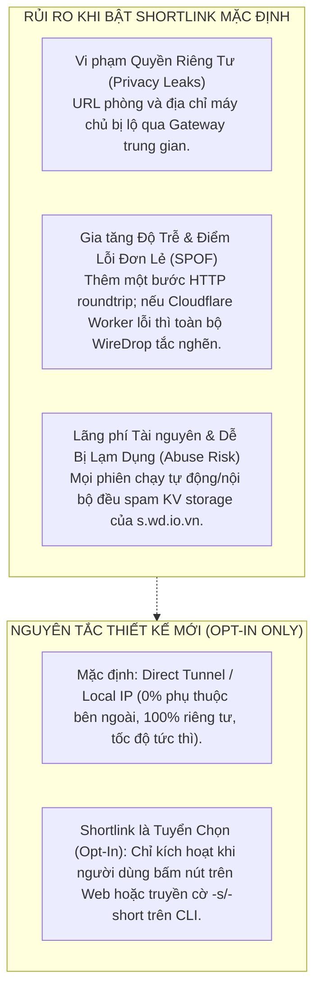
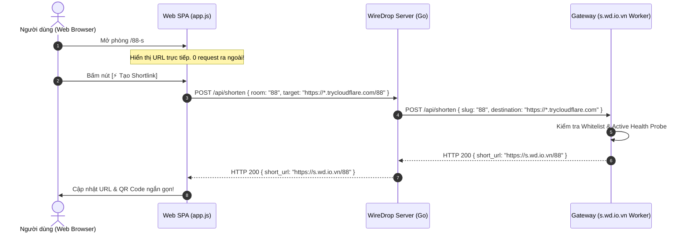
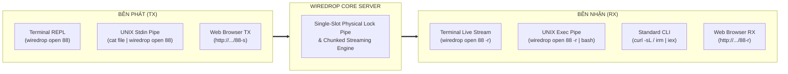

# ĐẶC TẢ KIẾN TRÚC: TERMINAL NATIVE PIPE & CƠ CHẾ RÚT GỌN LINK TUYỂN CHỌN
# (TERMINAL PIPE & SELECTIVE SHORTLINK SPECIFICATION)
# HỆ THỐNG: WireDrop v0.8.0-dev / v0.7.3+

**Loại tài liệu:** `📝 SPEC-PREPARE` (Tài Liệu Chuẩn Bị Đặc Tả Kiến Trúc & RFC)  
**Ngày khởi tạo:** 2026-11-19  
**Trạng thái:** Chờ Thẩm Định & Phê Duyệt Quyết Định (Pending Review & Approval)  
**Tác giả:** Đội ngũ Kiến trúc WireDrop  
**Ràng buộc bất biến:**  
* **100% Go Standard Library (Zero-Dependency)** — Tuyệt đối không thêm thư viện ngoài.  
* **0 Byte Ghi Đĩa Server** — Toàn bộ dòng dữ liệu (text/file) đi qua RAM Streaming hoặc Ping-Pong Buffering.  
* **Shortlink là Opt-in (0% Phụ thuộc ngầm)** — Mặc định chạy Direct Tunnel/Local IP, không phát sinh bất kỳ request nào ra ngoài gateway nếu người dùng không yêu cầu.  
* **Bảo toàn tương thích ngược CLI** — Mọi cú pháp `curl -sL`, `curl -sLJO`, `irm | iex` giữ nguyên hiệu lực 100%.

---

## MỤC LỤC
1. [Bối Cảnh & Động Lực Thiết Kế (Motivation & Problem Statement)](#1-bối-cảnh--động-lực-thiết-kế-motivation--problem-statement)
   - [1.1. Bản chất của Shortlink: Tiện ích bổ trợ, Tuyệt đối không phải luồng mặc định](#11-bản-chất-của-shortlink-tiện-ích-bổ-trợ-tuyệt-đối-không-phải-luồng-mặc-định)
   - [1.2. Sự dịch chuyển từ Trình duyệt sang Terminal-Native Pipe (`wiredrop open`)](#12-sự-dịch-chuyển-từ-trình-duyệt-sang-terminal-native-pipe-wiredrop-open)
2. [Kiến Trúc Luồng Rút Gọn Link Tuyển Chọn (Selective Shortlink Architecture)](#2-kiến-trúc-luồng-rút-gọn-link-tuyển-chọn-selective-shortlink-architecture)
   - [2.1. Ma trận chọn lọc trên FastHost Console & CLI](#21-ma-trận-chọn-lọc-trên-fasthost-console--cli)
   - [2.2. Ma trận chọn lọc trên Web UI (On-Demand Shorten Button)](#22-ma-trận-chọn-lọc-trên-web-ui-on-demand-shorten-button)
   - [2.3. Mô hình phòng vệ chống lạm dụng Gateway `s.wd.io.vn`](#23-mô-hình-phòng-vệ-chống-lạm-dụng-gateway-swdiovn)
3. [Đặc Tả Sợi Dây Terminal Trực Tiếp: `wiredrop open <room_id>`](#3-đặc-tả-sợi-dây-terminal-trực-tiếp-wiredrop-open-room_id)
   - [3.1. Triết lý thiết kế: Trải nghiệm như SSH / Netcat Pipe](#31-triết-lý-thiết-kế-trải-nghiệm-như-ssh--netcat-pipe)
   - [3.2. Cú pháp CLI & Hệ thống Cờ (Flags Specification)](#32-cú-pháp-cli--hệ-thống-cờ-flags-specification)
   - [3.3. Chế độ Đầu Phát Tương Tác (TX Interactive REPL Mode)](#33-chế-độ-đầu-phát-tương-tác-tx-interactive-repl-mode)
   - [3.4. Chế độ Đầu Nhận Luồng (RX Real-Time Stream Mode)](#34-chế-độ-đầu-nhận-luồng-rx-real-time-stream-mode)
   - [3.5. Đường Ống UNIX Tiêu Chuẩn (Standard UNIX Stdin/Stdout Piping)](#35-đường-ống-unix-tiêu-chuẩn-standard-unix-stdinstdout-piping)
   - [3.6. Chế độ Mở Trình Duyệt Web (`--web` / `-w`)](#36-chế-độ-mở-trình-duyệt-web---web---w)
4. [Đặc Tả Giao Thức Mạng & Mô Hình Tương Tác Chéo (Interoperability Matrix)](#4-đặc-tả-giao-thức-mạng--mô-hình-tương-tác-chéo-interoperability-matrix)
5. [Cấu Trúc Dữ Liệu & Bản Vẽ Kỹ Thuật (Data Structures & Technical Blueprint)](#5-cấu-trúc-dữ-liệu--bản-vẽ-kỹ-thuật-data-structures--technical-blueprint)
6. [Bảng Quyết Định Cần Phê Duyệt (Decision Matrix)](#6-bảng-quyết-định-cần-phê-duyệt-decision-matrix)

---

## 1. BỐI CẢNH & ĐỘNG LỰC THIẾT KẾ (MOTIVATION & PROBLEM STATEMENT)

### 1.1. Bản chất của Shortlink: Tiện ích bổ trợ, Tuyệt đối không phải luồng mặc định

Trong phiên bản `v0.7.2`, hệ thống đã tích hợp Cloudflare Worker Gateway cho tên miền `s.wd.io.vn` nhằm giải quyết vấn đề URL ngẫu nhiên của Cloudflare Quick Tunnel (`*.trycloudflare.com`) quá dài để gõ tay trên điện thoại di động.

Tuy nhiên, qua thẩm định kiến trúc sâu sắc, **Shortlink không thể và không bao giờ được phép là luồng hoạt động mặc định**. Việc biến shortlink thành mặc định vi phạm 3 nguyên lý nền tảng của WireDrop:



* **Kết luận định hướng:** Shortlink là một **tiện ích bổ trợ cực kỳ giá trị**, nhưng phải được kiểm soát chủ động bởi người dùng thông qua các giao diện tường minh (Explicit Flow).

---

### 1.2. Sự dịch chuyển từ Trình duyệt sang Terminal-Native Pipe (`wiredrop open`)

Người dùng công nghệ, kỹ sư hệ thống và DevOps thường xuyên làm việc trên terminal, qua SSH remote server, tmux hoặc PowerShell không có sẵn môi trường GUI hay trình duyệt web.

Trước đây, khi muốn truyền tin hoặc file qua CLI, người dùng phải nhớ câu lệnh `curl -sL ...` phức tạp hoặc phải phụ thuộc vào việc mở trình duyệt web.

**Đột phá kiến trúc:** Lệnh `wiredrop open <room_id>` được định nghĩa lại:
* **Không mặc định mở Web Browser!**
* Thay vào đó, nó mở ra một **Sợi dây Terminal Tương tác Thuần túy (Terminal-Native Interactive Pipe)**:
  * Bên phát (TX): Trở thành một phiên REPL (Read-Eval-Print Loop) tức thời. Người dùng gõ text, paste script hoặc gõ lệnh `:file <path>` $\rightarrow$ Dữ liệu bắn thẳng sang đầu nhận.
  * Bên nhận (RX): Trở thành một luồng live stream. Từng dòng chữ, log hoặc byte file chạy ra màn hình terminal theo thời gian thực (tương tự `tail -f` hoặc `netcat -l`).
  * Tích hợp sâu vào UNIX Pipeline: Dễ dàng ghép nối với `| grep`, `| bash`, `cat file | wiredrop open 88`.
  * Nếu người dùng thực sự muốn mở Web Browser, họ chỉ cần truyền cờ `--web` hoặc `-w`.

---

## 2. KIẾN TRÚC LUỒNG RÚT GỌN LINK TUYỂN CHỌN (SELECTIVE SHORTLINK ARCHITECTURE)

### 2.1. Ma trận chọn lọc trên FastHost Console & CLI

Khi khởi động FastHost qua binary (`wiredrop-portable.exe` hoặc `wiredrop host`), menu tương tác được thiết kế lại nhằm tôn trọng nguyên tắc **Direct First**:

```text
================================================================
     ⚡ WIREDROP FASTHOST PORTABLE - SELECTION MENU            
================================================================
 [1] Quick Tunnel Trực Tiếp (Mặc định - Nhanh nhất, Không trung gian)
 [2] Quick Tunnel + Rút gọn Shortlink (s.wd.io.vn - Dễ gõ Mobile)
 [3] Domain cá nhân cố định (Named Tunnel Token)
 [4] Chỉ chạy mạng nội bộ (Local Only - 100% Offline)
 [0] Thoát
----------------------------------------------------------------
Lựa chọn của bạn [1/2/3/4/0] (Mặc định: 1): _
```

#### Bảng Tùy Chọn CLI Flags:
| Lệnh / Cờ CLI | Ý nghĩa | Hành vi mạng của Gateway `s.wd.io.vn` |
| :--- | :--- | :--- |
| `wiredrop host` | Khởi động FastHost mặc định | **Không gọi gateway**. Xuất URL `https://*.trycloudflare.com` trực tiếp. |
| `wiredrop host -short` (hoặc `-s`) | Khởi động FastHost kèm rút gọn link | Gửi POST tới `s.wd.io.vn/api/shorten`, in ra link ngắn `https://s.wd.io.vn/<slug>`. |
| `wiredrop host -room <id> [-s]` | Khởi động với phòng cố định | Tự tạo phòng theo mã `<id>`, tùy chọn rút gọn nếu có cờ `-s`. |
| `wiredrop host -port <p>` | Đổi cổng lắng nghe | Lắng nghe trên cổng chỉ định (mặc định 8080). |

---

### 2.2. Ma trận chọn lọc trên Web UI (On-Demand Shorten Button)

Trên giao diện Web (`public/index.html` và `public/app.js`):
1. **Trạng thái ban đầu:** Ô hiển thị URL chỉ chứa link phòng trực tiếp (ví dụ: `https://abcd-1234.trycloudflare.com/88-s`). Mã QR Code sinh trực tiếp từ URL này. Tuyệt đối không gửi request nào ra ngoài.
2. **Nút On-Demand `[⚡ Tạo Shortlink]`:**
   * Nằm cạnh nút `Sao chép Link`.
   * Khi người dùng nhấp vào nút này:
     * Frontend gọi API `POST /api/shorten` trên WireDrop Server nội bộ (hoặc gọi trực tiếp Cloudflare Worker Gateway nếu cấu hình).
     * Trạng thái nút chuyển thành spinner: `Đang tạo...`.
     * Khi thành công: Ô URL đổi thành `https://s.wd.io.vn/88-s` (hoặc `88-r`), QR Code vẽ lại theo link ngắn, và nút chuyển thành `Đã rút gọn`.
     * Nếu mạng lỗi hoặc Gateway không khả dụng: Giữ nguyên link gốc và hiển thị thông báo nhẹ (Toast notification): `Không thể tạo shortlink, giữ nguyên link gốc`.



---

### 2.3. Mô hình phòng vệ chống lạm dụng Gateway `s.wd.io.vn`

Để đảm bảo tên miền cá nhân `s.wd.io.vn` không bị lợi dụng làm bàn đạp phát tán mã độc (phishing/malware), kiến trúc Cloudflare Worker duy trì cơ chế phòng vệ 4 lớp nghiêm ngặt:

```
[Request Tạo Shortlink]
         │
         ▼
 ┌────────────────────────────────────────────────────────┐
 │ Lớp 1: Destination Whitelist Regex                      │
 │ Chỉ cho phép đích đến là *.trycloudflare.com           │
 └───────────────────────┬────────────────────────────────┘
                         ▼ (Hợp lệ)
 ┌────────────────────────────────────────────────────────┐
 │ Lớp 2: Active Health Probe                             │
 │ Worker chủ động gọi GET {destination}/health           │
 │ Bắt buộc phản hồi HTTP 200 trong vòng 2 giây           │
 └───────────────────────┬────────────────────────────────┘
                         ▼ (Pass Probe)
 ┌────────────────────────────────────────────────────────┐
 │ Lớp 3: Giới Hạn Tần Suất (IP Rate Limit) & Dung Lượng   │
 │ Tối đa 20 request / 10 phút trên mỗi IP                │
 │ Body JSON giới hạn < 2 KB                              │
 └───────────────────────┬────────────────────────────────┘
                         ▼ (Hợp lệ)
 ┌────────────────────────────────────────────────────────┐
 │ Lớp 4: Ephemeral Auto-Destruction (TTL Tự Hủy)          │
 │ Lưu trữ Cloudflare KV tự hủy sau 30 phút (TTL = 1800s) │
 └────────────────────────────────────────────────────────┘
```

---

## 3. ĐẶC TẢ SỢI DÂY TERMINAL TRỰC TIẾP: `wiredrop open <room_id>`

### 3.1. Triết lý thiết kế: Trải nghiệm như SSH / Netcat Pipe

Lệnh `wiredrop open <room_id>` biến cửa sổ terminal thành một cổng kết nối trực tiếp vào sợi dây vật lý của WireDrop. Không cần giao diện đồ họa, không cần JavaScript, không cần mở trình duyệt web.

* **Cảm giác sử dụng:** Gần gũi và tự nhiên như khi gõ lệnh `nc -l` (Netcat) hoặc mở một phiên SSH pipe.
* **Tốc độ:** Khởi động tức thì trong `< 10ms`, chiếm RAM `< 5MB`.
* **Hai vai trò rõ ràng:**
  * **TX (Bên phát):** REPL Console gửi lệnh / file.
  * **RX (Bên nhận):** Terminal Receiver hiển thị dòng / đón file.

---

### 3.2. Cú pháp CLI & Hệ thống Cờ (Flags Specification)

```text
CÚ PHÁP:
  wiredrop open <room_id> [flags]

CÁC CỜ HỖ TRỢ:
  -r, --rx           Chế độ Nhận (Receiver): Mở luồng lắng nghe và hiển thị nội dung phòng ra stdout
  -s, --short        Ưu tiên hiển thị và kết nối qua Gateway Shortlink (s.wd.io.vn)
  -w, --web          Mở phòng bằng trình duyệt web mặc định của hệ điều hành
  -f, --file <path>  Bắn trực tiếp 1 file vào phòng rồi giữ kết nối
  -u, --url <addr>   Chỉ định địa chỉ WireDrop Server từ xa (Mặc định: biến WIREDROP_SERVER hoặc localhost:8080)
  -q, --quiet        Chế độ im lặng (Tắt banner, chỉ in raw stream - dùng cho UNIX Pipe)
  -h, --help         In bảng hướng dẫn sử dụng
```

---

### 3.3. Chế độ Đầu Phát Tương Tác (TX Interactive REPL Mode)

Khi người dùng thực hiện:
```bash
wiredrop open 88
```

Giao diện Terminal REPL hiển thị ngay lập tức:

```text
================================================================
  ⚡ WIREDROP TERMINAL PIPE TX (Phòng: 88)
================================================================
  • Máy Nhận kết nối bằng lệnh:
    CLI Linux/macOS:    curl -sL http://localhost:8080/88-r | sh
    CLI PowerShell:     irm http://localhost:8080/88-r | iex
    Terminal Pipe RX:   wiredrop open 88 -r
    Web UI:             http://localhost:8080/88-r
  • Hướng dẫn: Gõ bất kỳ nội dung nào và gõ [Enter] để truyền.
  • Lệnh REPL: :file <path> | :clear | :status | :help | :exit
================================================================
[88-s:TX]> _
```

#### Xử lý Dòng Lệnh trong REPL:
1. **Truyền Text / Kịch bản thông thường:**
   * Bất kỳ dòng text nào người dùng gõ vào prompt sẽ được gửi ngay lập tức qua HTTP `POST /{room}-s?live=1`.
   * Nếu người dùng dán (paste) nhiều dòng code: Bộ đệm đọc toàn bộ block và stream liên tục sang RX.
2. **Hệ thống Lệnh Nội Bộ REPL (Bắt đầu bằng dấu hai chấm `:`):**
   * `:file <path>`:
     * Kiểm tra file trên đĩa cứng cục bộ.
     * Tự động chuyển đổi sang giao thức nạp mảnh Chunked Transfer của WireDrop, hiển thị thanh tiến độ ngay trong terminal:
       ```text
       [88-s:TX]> :file ./database_dump.tar.gz
       [*] Bắt đầu truyền file: database_dump.tar.gz (450.0 MB)
       [██████████████░░░░░░]  70% (315.0/450.0 MB) - 24.5 MB/s
       [OK] Truyền file hoàn tất! Quay lại chế độ Terminal Pipe.
       [88-s:TX]> _
       ```
   * `:clear`: Xóa màn hình terminal và gửi tín hiệu xóa bộ đệm phòng sang RX (`POST /{room}-s?clear=1`).
   * `:status`: Truy vấn API `/health` hoặc SSE trạng thái phòng, in thông tin:
     * Tình trạng RX: `ONLINE (1 Active Connection)` hoặc `WAITING (Chưa có máy nhận)`.
     * Tổng số byte đã truyền trong phiên làm việc.
   * `:help`: In danh sách các lệnh nội bộ.
   * `:exit` hoặc `Ctrl+C`: Đóng luồng an toàn và trả lại shell.

---

### 3.4. Chế độ Đầu Nhận Luồng (RX Real-Time Stream Mode)

Khi máy nhận thực thi:
```bash
wiredrop open 88 -r
```

Quy trình hoạt động:
1. Client thiết lập kết nối HTTP `GET /{room}-r?live=1` (kèm header `Accept: text/plain` hoặc SSE).
2. Khi Server nhận dữ liệu từ TX: Dữ liệu được xả thẳng ra `os.Stdout` của terminal RX từng dòng một.
3. Nếu TX gửi một file nhị phân (Header `Content-Disposition: attachment; filename="..."`):
   * Terminal RX tự động phát hiện tên file và kích thước.
   * Hiển thị thanh tiến độ nhận file:
     ```text
     [*] Đang nhận file: database_dump.tar.gz (450.0 MB)...
     [████████████████████] 100% (450.0/450.0 MB) - 32.1 MB/s
     [OK] Đã lưu an toàn: ./database_dump.tar.gz
     ```
   * File được ghi trực tiếp xuống đĩa cứng của máy RX mà không qua bước trung gian.

---

### 3.5. Đường Ống UNIX Tiêu Chuẩn (Standard UNIX Stdin/Stdout Piping)

WireDrop CLI tự động kiểm tra xem Stdin / Stdout có phải là thiết bị TTY tương tác hay không (thông qua `term.IsTerminal` hoặc kiểm tra `os.ModeCharDevice`).

#### Trường hợp 1: Pipe Stdin vào Bên Phát (Non-interactive Pipe)
```bash
cat update_system.sh | wiredrop open 88
```
* CLI nhận biết Stdin có dữ liệu từ đường ống (`os.ModeCharDevice == 0`).
* Tự động tắt toàn bộ banner REPL.
* Đọc dữ liệu từ Stdin và truyền liên tục qua HTTP `POST /{room}-s` cho đến khi gặp `EOF`.
* Tự động thoát với Exit Code 0 sau khi truyền xong.

#### Trường hợp 2: Pipe Đầu Ra Bên Nhận vào Shell hoặc Công Cụ Khác
```bash
# Pipe trực tiếp vào Bash
wiredrop open 88 -r -q | bash

# Lọc log trực tiếp
wiredrop open 88 -r -q | grep "CRITICAL"
```
* Cờ `-q` (Quiet) hoặc việc Stdout bị pipe sẽ kích hoạt chế độ **Raw Stream Mode**: Tuyệt đối không in ký tự điều khiển ANSI, không in banner, chỉ đẩy đúng luồng byte nhận được sang tiến trình tiếp theo.

---

### 3.6. Chế độ Mở Trình Duyệt Web (`--web` / `-w`)

Khi người dùng muốn mở giao diện Web quen thuộc từ terminal:
```bash
wiredrop open 88 --web
# hoặc
wiredrop open 88 -w -s
```
* CLI kích hoạt cơ chế `openBrowser(url)` đa nền tảng:
  * **Windows:** `rundll32 url.dll,FileProtocolHandler <url>` hoặc `powershell Start-Process <url>`.
  * **macOS:** `open <url>`.
  * **Linux:** `xdg-open <url>`.
* Nếu có cờ `-s` / `--short`, URL truyền cho trình duyệt là link đã rút gọn qua `s.wd.io.vn`.

---

## 4. ĐẶC TẢ GIAO THỨC MẠNG & MÔ HÌNH TƯƠNG TÁC CHÉO (INTEROPERABILITY MATRIX)

Hệ thống đảm bảo tính liên kết xuyên suốt giữa mọi loại thiết bị và phương thức kết nối:



### Bảng Ma Trận Tương Thích Chéo (Interoperability Matrix):
| Bên Phát (TX) | Bên Nhận (RX) | Trải nghiệm người dùng | Giao thức truyền tải |
| :--- | :--- | :--- | :--- |
| **Terminal REPL** (`open 88`) | **Terminal RX** (`open 88 -r`) | Chat terminal tức thời, hỗ trợ bắn file `:file` | HTTP Line Streaming (`?live=1`) |
| **Terminal REPL** (`open 88`) | **Web Browser** (`/88-r`) | Từng dòng gõ trên terminal hiện real-time lên màn hình Web | SSE (`/88/events`) $\rightarrow$ DOM Rendering |
| **Terminal REPL** (`open 88`) | **Curl / Irm** (`curl -sL ...`) | Dòng lệnh gõ ra được curl hứng trọn và thực thi | Raw HTTP chunked stream |
| **Web Browser** (`/88-s`) | **Terminal RX** (`open 88 -r`) | Soạn thảo kịch bản trên Web, bấm phát hiện ngay trên terminal | HTTP Event Stream / Chunked pipe |
| **UNIX Stdin** (`cat | open`) | **UNIX Pipe** (`open -r | bash`)| Truyền script tự động không chạm giữa 2 máy chủ | Raw Stdin/Stdout Zero-Copy Stream |

---

## 5. CẤU TRÚC DỮ LIỆU & BẢN VẼ KỸ THUẬT (DATA STRUCTURES & TECHNICAL BLUEPRINT)

### 5.1. Cấu Trúc Mã Nguồn Đề Xuất
Để đảm bảo nguyên tắc tổ chức mã nguồn tinh gọn và không phình to file:

```text
E:\TT\WireDrop\
├── main.go               # Điều hướng CLI subcommand: 'host', 'server', 'open'
├── host.go               # FastHost Runner, Cloudflare Tunnel & Shortlink Gateway client
├── term_pipe.go          # [MỚI] Module xử lý Terminal-Native Pipe & REPL ('wiredrop open')
├── handler_pipe.go       # HTTP Handlers cho Sợi dây 2 đầu (*-s, *-r, /chunk, /api/shorten)
├── room.go               # Memory RoomState, Mutex locks, TTL Cleaner
├── sync_test.go          # Bộ Unit Tests & Integration Tests toàn diện
├── gateway/
│   ├── worker.js         # Cloudflare Worker triển khai trên domain s.wd.io.vn
│   └── wrangler.toml     # File cấu hình deploy Cloudflare Worker
└── public/
    ├── index.html        # Web SPA UI (bổ sung nút Tạo Shortlink On-Demand)
    ├── app.js            # Frontend logic (tích hợp API shorten & QR update)
    └── style.css         # Retro Monochrome Theme
```

### 5.2. Luồng Điều Hướng trong `main.go`
```go
func main() {
    args := os.Args[1:]
    if len(args) > 0 {
        switch args[0] {
        case "open":
            runTerminalPipeCommand(args[1:])
            return
        case "host", "--host":
            runPortableHost()
            return
        case "server", "--server":
            // Chạy server thông thường
        }
    }
    // ... Khởi chạy mặc định theo portable hoặc server flag
}
```

---

## 6. BẢNG QUYẾT ĐỊNH CẦN PHÊ DUYỆT (DECISION MATRIX)

Trước khi tiến hành lập trình phiên bản `v0.8.0`, kính chuyển người dùng xem xét và phê duyệt 5 quyết định kiến trúc:

| Mã số | Hạng mục thẩm định | Phương án đề xuất (Khuyến nghị) | Phương án thay thế | Lý do lựa chọn khuyến nghị |
| :-: | :--- | :--- | :--- | :--- |
| **Q1** | **Vị thế mặc định của Shortlink** | **Tuyển chọn (Opt-in Only):** Mặc định chạy Direct Tunnel / Local IP. Chỉ gọi `s.wd.io.vn` khi người dùng bấm nút hoặc truyền cờ `-s`. | Bật shortlink tự động cho mọi lần chạy | Đảm bảo tính riêng tư 100%, triệt tiêu độ trễ mạng phụ, và bảo vệ tài nguyên domain `s.wd.io.vn`. |
| **Q2** | **Bản chất của lệnh `wiredrop open`** | **Mở Terminal-Native Pipe / REPL trực tiếp trên console.** | Mở trình duyệt web mặc định | Hướng tới bản chất tối giản, mạnh mẽ của Unix CLI; phục vụ môi trường server không có giao diện đồ họa. |
| **Q3** | **Cú pháp mở trình duyệt web** | **`wiredrop open <room> --web` (hoặc `-w`).** | Tạo lệnh riêng như `wiredrop browse` | Gom chung dưới nhóm hành vi "mở phòng", giảm bớt số lượng subcommand phải nhớ. |
| **Q4** | **Lệnh nội bộ REPL (`:file`)** | **Hỗ trợ nạp file lớn bằng lệnh `:file <path>` ngay trong REPL console.** | Bắt người dùng thoát ra gõ lệnh khác | Giúp người dùng truyền text và file qua lại linh hoạt trong cùng một phiên làm việc mà không đứt kết nối. |
| **Q5** | **Giao diện Web On-Demand Shortlink** | **Thêm nút `[⚡ Tạo Shortlink]` cạnh nút Copy Link.** | Luôn hiển thị checkbox trong cài đặt | Nút bấm trực quan, khi cần mới click, không làm rối giao diện Retro Monochrome tối giản. |

---

*Tài liệu sẵn sàng để phê duyệt. Sau khi chốt các câu hỏi trên, hệ thống sẽ tiến hành lập trình module `term_pipe.go`, tinh chỉnh Web UI và cập nhật changelog theo đúng quy chuẩn.*
