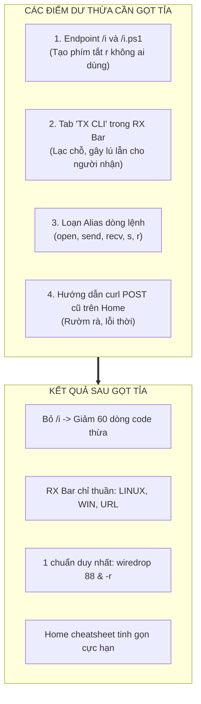

# ĐẶC TẢ KIẾN TRÚC: RÀ SOÁT TỐI GIẢN HÓA CỰC HẠN, GỌT TỈA RÂU RIA & ĐÓNG BĂNG PHẠM VI
# (CODEBASE PRUNING & MINIMALIST HARDENING SPECIFICATION)
# HỆ THỐNG: WireDrop v0.8.x

**Loại tài liệu:** `📝 SPEC-PREPARE` (Tài Liệu Chuẩn Bị Đặc Tả Kiến Trúc & RFC)  
**Ngày khởi tạo:** 2026-11-19  
**Trạng thái:** Chờ Thẩm Định & Phê Duyệt Quyết Định (Pending Review & Approval)  
**Tác giả:** Đội ngũ Kiến trúc WireDrop  
**Kim chỉ nam tối thượng:**  
> **"A giao dịch với B để ít quy trình nhất — Chân lý tối giản để vừa đạt."**  
> *(Perfection is achieved, not when there is nothing more to add, but when there is nothing left to take away.)*

---

## MỤC LỤC
1. [Bối Cảnh & Động Lực: Chống Bệnh Phình To Tính Năng (Combatting Feature Creep)](#1-bối-cảnh--động-lực-chống-bệnh-phình-to-tính-năng-combatting-feature-creep)
   - [1.1. Nỗi lo mất kiểm soát và sự tích tụ "râu ria"](#11-nỗi-lo-mất-kiểm-soát-và-sự-tích-tụ-râu-ria)
   - [1.2. Nhìn lại Nỗi Đau Nguyên Bản (The Genesis Pain Point)](#12-nhìn-lại-nỗi-đau-nguyên-bản-the-genesis-pain-point)
2. [Kiểm Toán Toàn Diện Codebase Hiện Tại (Comprehensive Codebase Audit)](#2-kiểm-toán-toàn-diện-codebase-hiện-tại-comprehensive-codebase-audit)
   - [2.1. Thống kê định lượng mã nguồn](#21-thống-kê-định-lượng-mã-nguồn)
   - [2.2. Đánh giá 4 Trụ cột Xương sống (Core Essentials - Giữ vững)](#22-đánh-giá-4-trụ-cột-xương-sống-core-essentials---giữ-vững)
3. [Giải Phẫu & Kế Hoạch Gọt Tỉa 4 Điểm "Râu Ria" (Fluff & Redundancy Pruning)](#3-giải-phẫu--kế-hoạch-gọt-tỉa-4-điểm-râu-ria-fluff--redundancy-pruning)
   - [3.1. Râu ria 1: Endpoint `/i` và `/i.ps1` (Bootstrap Alias `r`)](#31-râu-ria-1-endpoint-i-và-ips1-bootstrap-alias-r)
   - [3.2. Râu ria 2: Tab `TX CLI` nằm lạc chỗ trong Thanh RX Bar trên Web](#32-râu-ria-2-tab-tx-cli-nằm-lạc-chỗ-trong-thanh-rx-bar-trên-web)
   - [3.3. Râu ria 3: Quá nhiều alias dòng lệnh rườm rà trong `term_pipe.go`](#33-râu-ria-3-quá-nhiều-alias-dòng-lệnh-rườm-rà-trong-term_pipego)
   - [3.4. Râu ria 4: Cú pháp hướng dẫn cũ trên Home Cheatsheet](#34-râu-ria-4-cú-pháp-hướng-dẫn-cũ-trên-home-cheatsheet)
4. [Tuyên Bố Đóng Băng Phạm Vi (Scope Freeze & Boundary Protection)](#4-tuyên-bố-đóng-băng-phạm-vi-scope-freeze--boundary-protection)
   - [4.1. Khóa chặt phạm vi sản phẩm (Feature-Complete)](#41-khóa-chặt-phạm-vi-sản-phẩm-feature-complete)
   - [4.2. Từ chối dứt khoát luồng SSH hai chiều / Remote Shell](#42-từ-chối-dứt-khoát-luồng-ssh-hai-chiều--remote-shell)
5. [Bảng Quyết Định Cần Phê Duyệt (Decision Matrix)](#5-bảng-quyết-định-cần-phê-duyệt-decision-matrix)

---

## 1. BỐI CẢNH & ĐỘNG LỰC: CHỐNG BỆNH PHÌNH TO TÍNH NĂNG (COMBATTING FEATURE CREEP)

### 1.1. Nỗi lo mất kiểm soát và sự tích tụ "râu ria"

Trong quá trình phát triển phần mềm, khi một công cụ đã giải quyết xong bài toán cốt lõi, đội ngũ phát triển rất dễ rơi vào trạng thái:
* **Nghĩ thêm nhiều kịch bản tưởng tượng:** Thấy cái gì cũng hay, liên tục đẻ ra các nhánh rẽ ("lỡ như người dùng muốn thế này...", "lỡ như có người cần thế nọ...").
* **Sự tích lũy vô thức của râu ria (Accidental Complexity):** Thêm một cờ dòng lệnh, thêm một endpoint dự phòng, thêm một tab giao diện... Dù từng chi tiết nhỏ trông có vẻ "tiện", nhưng tổng hòa lại chúng tạo ra một gánh nặng nhận thức (Cognitive Overhead) khổng lồ, khiến cả người dùng lẫn tác giả đều cảm thấy **ngợp và mất kiểm soát**.

> **Nguyên tắc vàng:** "Thừa 1 trường hợp mà không có tác dụng thực tế cũng là một vấn đề nghiêm trọng. Tối giản là nghệ thuật biết dừng lại đúng lúc khi mục tiêu vừa đạt."

---

### 1.2. Nhìn lại Nỗi Đau Nguyên Bản (The Genesis Pain Point)

WireDrop sinh ra không phải để cạnh tranh với SSH, TeamViewer hay Google Drive. Nó sinh ra từ một **nỗi đau cực kỳ cụ thể**:

```
[MÁY THẬT A]                                            [MÁY ẢO VMWARE B]
Có sẵn đoạn script dài 50 dòng             ────────>     Máy ảo trắng tinh, OS tối giản
hoặc file cài đặt 2GB                                    Không có Clipboard chung (No VM Tools)
                                                         Không có SSH, Không có Browser
                                                         BẮT BUỘC PHẢI GÕ TAY TỪNG KÝ TỰ!
```

* **Vấn đề duy nhất cần giải quyết:** Làm sao để người ngồi ở Máy B **chỉ cần gõ một số lượng ký tự ít nhất trên bàn phím**, không cần đăng nhập bất kỳ tài khoản nào, là có thể kéo toàn bộ đoạn text hoặc file từ Máy A sang!
* **Bản chất của giao dịch:** **Một chiều, Tạm thời, Không rác, Cực tiểu hóa quy trình.**

---

## 2. KIỂM TOÁN TOÀN DIỆN CODEBASE HIỆN TẠI (COMPREHENSIVE CODEBASE AUDIT)

### 2.1. Thống kê định lượng mã nguồn

Hệ thống hiện tại gồm 12 tập tin với dung lượng rất tinh gọn:

```text
E:\TT\WireDrop\
├── handler_pipe.go    ~970 dòng (28.4 KB)  # HTTP Handlers cho Sợi dây 2 đầu
├── host.go            ~640 dòng (19.6 KB)  # FastHost Cloudflare Tunnel & Shortlink
├── main.go            ~300 dòng (9.3 KB)   # ServeMux, Router & CLI Subcommands
├── room.go            ~550 dòng (16.9 KB)  # Bộ nhớ RAM, 256KB sync.Pool & Mutex
├── term_pipe.go       ~580 dòng (18.8 KB)  # Terminal-Native Pipe & REPL
├── sync_test.go       ~1.230 dòng (43.3 KB)# 20 Unit & Integration Tests (Pass 100%)
├── gateway/worker.js  ~230 dòng (9.0 KB)   # Cloudflare Worker cho s.wd.io.vn
└── public/
    ├── index.html     ~285 dòng (16.9 KB)  # Web SPA HTML
    ├── app.js         ~1.110 dòng (52.1 KB)# Client Logic
    └── style.css      ~550 dòng (12.0 KB)  # Retro Monochrome CSS
```

---

### 2.2. Đánh giá 4 Trụ cột Xương sống (Core Essentials - Giữ vững)

Toàn bộ 4 thành phần sau đây đạt 100% chuẩn mực "vừa đủ để đạt mục tiêu" và **tuyệt đối không được đụng chạm làm hỏng**:

1. **Khóa kết nối vật lý 1-1 (`HTTP 409`):** Đảm bảo tính toàn vẹn tuyệt đối của sợi dây truyền tin.
2. **Động cơ truyền file lớn Zero-Disk (Turbo 256KB Sub-Chunk):** Cho phép truyền file nhiều GB qua RAM mà không tốn 1 byte ổ cứng server.
3. **Cổng Shortlink Gateway `s.wd.io.vn` (Dạng Opt-in):** Cho phép người gõ tay trên máy ảo gõ đúng 12 ký tự (`s.wd.io.vn/88-r`) thay vì 60 ký tự Cloudflare.
4. **Cú pháp siêu ngắn Terminal Pipe:** `wiredrop 88` (phát) và `wiredrop 88 -r` (nhận).

---

## 3. GIẢI PHẪU & KẾ HOẠCH GỌT TỈA 4 ĐIỂM "RÂU RIA" (FLUFF & REDUNDANCY PRUNING)

Qua rà soát từng dòng code, chúng ta định danh được **4 điểm râu ria / dư thừa** cần được gọt tỉa dứt khoát:



---

### 3.1. Râu ria 1: Endpoint `/i` và `/i.ps1` (Bootstrap Alias `r`)
* **Thực trạng:** 
  * Trong `handler_pipe.go` có 2 hàm `handleInitScriptLinux` và `handleInitScriptWindows`.
  * Khi người dùng gọi `curl s.wd.io.vn/i | sh`, nó tạo ra một hàm alias `r()` để gõ `r 88`.
* **Phân tích thực tế:**
  * **Tại sao nó là râu ria?** Người ngồi trước máy ảo hoặc terminal xa lạ chỉ muốn nhận dữ liệu ngay. Việc bắt họ chạy 1 câu lệnh cài đặt `/i` trước, rồi mới chạy lệnh `r 88` sau là **tăng thêm 1 bước quy trình vô ích**!
  * Câu lệnh trực tiếp `curl -sL s.wd.io.vn/88-r | sh` vốn dĩ chỉ có **28 ký tự**, gõ một lần là xong việc ngay.
* **Kế hoạch gọt tỉa:**
  * Xóa bỏ 2 hàm `handleInitScriptLinux` và `handleInitScriptWindows` trong `handler_pipe.go`.
  * Xóa route `GET /i` và `GET /i.ps1` trong `main.go`.
  * Tiết kiệm ~60 dòng code backend, loại bỏ hoàn toàn một khái niệm thừa thãi.

---

### 3.2. Râu ria 2: Tab `TX CLI` nằm lạc chỗ trong Thanh RX Bar trên Web
* **Thực trạng:**
  * Trong `public/index.html` (dòng 175–180), thanh lệnh đáy ghi tiêu đề:  
    `LỆNH CHẠY TRÊN MÁY ĐÍCH (RX):`
  * Nhưng bên cạnh các tab `LINUX`, `WIN`, `URL` lại có thêm tab:  
    `<button class="os-tab" data-os="tx">TX CLI</button>`.
* **Phân tích thực tế:**
  * **Tại sao nó là râu ria?** Đây là thanh công cụ dành cho **Người Nhận (RX)**. Người nhận chỉ quan tâm cách lấy dữ liệu về máy mình (bằng Linux curl, Windows PowerShell, hay link trình duyệt). Đưa tab "TX CLI" (lệnh đẩy kịch bản của bên gửi) vào đây khiến giao diện bị nhập nhằng vai trò và gây bối rối cho người dùng.
* **Kế hoạch gọt tỉa:**
  * Xóa bỏ tab `data-os="tx"` khỏi thanh RX bar trong `public/index.html`.
  * Xóa bỏ nhánh `if (os === "tx")` trong `public/app.js`.
  * Thanh RX bar chỉ giữ đúng 3 tab tự nhiên: **`LINUX`**, **`WIN`**, **`URL`**.

---

### 3.3. Râu ria 3: Quá nhiều alias dòng lệnh rườm rà trong `term_pipe.go`
* **Thực trạng:**
  * `parseTerminalPipeArgs` đang hỗ trợ một danh sách dài các từ khóa: `open`, `send`, `recv`, `s`, `r`, `--rx`, `-rx`, `--r`...
* **Phân tích thực tế:**
  * **Tại sao nó là râu ria?** Có quá nhiều cách để làm một việc chứng tỏ sản phẩm chưa có độ định hình dứt khoát. Người dùng đọc tài liệu sẽ phân vân không biết nên gõ `wiredrop open 88` hay `wiredrop send 88` hay `wiredrop 88`.
* **Kế hoạch gọt tỉa:**
  * **Chuẩn hóa duy nhất 1 cú pháp chính thức:**
    * Phát tin/file: **`wiredrop <room>`**
    * Nhận tin/file: **`wiredrop <room> -r`**
  * Giữ cờ `-s` (shortlink) và `-w` (web) khi cần.
  * Tinh giản code phân tích flag trong `term_pipe.go`, loại bỏ các chuỗi so sánh thừa.

---

### 3.4. Râu ria 4: Cú pháp hướng dẫn cũ trên Home Cheatsheet
* **Thực trạng:**
  * Trang chủ `/#` (trong `public/index.html` dòng 55–60) vẫn in dòng lệnh:  
    `curl -s -X POST --data-binary @script.sh host/:room-s`
* **Phân tích thực tế:**
  * Cú pháp `curl -X POST --data-binary` quá dài dòng và phức tạp đối với người dùng thông thường, làm giảm đi cảm giác thanh thoát của WireDrop.
* **Kế hoạch gọt tỉa:**
  * Cập nhật Cheat Sheet cột 1 trên trang chủ thành cú pháp siêu ngắn hiện đại:  
    `cat script.sh | wiredrop :room`  
    *(kèm chú thích: "Hoặc kéo thả file trực tiếp vào trình duyệt")*.

---

## 4. TUYÊN BỐ ĐÓNG BĂNG PHẠM VI (SCOPE FREEZE & BOUNDARY PROTECTION)

### 4.1. Khóa chặt phạm vi sản phẩm (Feature-Complete)

Kể từ thời điểm này, WireDrop được tuyên bố là **ĐÃ ĐẦY ĐỦ TÍNH NĂNG (Feature-Complete)**.

Mọi đề xuất tính năng mới trong tương lai sẽ bị từ chối nếu vi phạm **Bộ Lọc Quyết Định (The WireDrop Razor)**:

```
                            ┌──────────────────────────────────────┐
                            │    BỘ LỌC QUYẾT ĐỊNH (THE RAZOR)     │
                            │  "Tính năng này có giúp việc BẮN     │
                            │  DỮ LIỆU từ A sang B ít bước hơn?"   │
                            └──────────────────┬───────────────────┘
                                               │
                        ┌──────────────────────┴──────────────────────┐
                        ▼                                             ▼
                     [ CÓ ]                                        [ KHÔNG ]
             Cân nhắc xem có tối giản                      Loại bỏ ngay lập tức!
             để vừa đạt hay không.                         (Không do dự)
```

### 4.2. Từ chối dứt khoát luồng SSH hai chiều / Remote Shell
* **Quyết định dứt khoát:** WireDrop **TUYỆT ĐỐI KHÔNG** phát triển thành SSH hai chiều hay Remote Execution.
* **Lý do:**
  1. Sai lệch hoàn toàn mục tiêu gốc ("truyền dữ liệu" biến thành "quản trị hệ thống").
  2. Phá vỡ tính an toàn (dễ bị nhận diện nhầm là Trojan / Backdoor).
  3. Gây bùng nổ độ phức tạp (session state, PTY, authentication).

---

## 5. BẢNG QUYẾT ĐỊNH CẦN PHÊ DUYỆT (DECISION MATRIX)

Kính chuyển tác giả xem xét và phê duyệt 4 quyết định gọt tỉa trước khi tiến hành làm sạch mã nguồn:

| Mã số | Hạng mục đề xuất gọt tỉa | Hành động cụ thể | Lợi ích đạt được |
| :-: | :--- | :--- | :--- |
| **Q1** | **Xóa bỏ endpoint `/i` và `/i.ps1`** | Xóa khỏi `handler_pipe.go` và `main.go`. | Cắt giảm 60 dòng code thừa; loại bỏ quy trình cài alias không cần thiết. |
| **Q2** | **Xóa tab `TX CLI` khỏi RX Bar** | Xóa nút khỏi `index.html` và code điều phối trong `app.js`. | Trả lại sự trong sáng, đúng nghĩa 100% cho thanh lệnh dành cho Người Nhận. |
| **Q3** | **Chuẩn hóa cú pháp dòng lệnh duy nhất** | Chỉ truyền thông: `wiredrop <room>` và `wiredrop <room> -r`. | Triệt tiêu sự phân mảnh nhận thức; gõ ít nhất, dễ nhớ nhất. |
| **Q4** | **Cập nhật Cheatsheet Trang Chủ** | Thay thế lệnh curl POST dài bằng cú pháp pipe hiện đại. | Giao diện thanh thoát, trực quan, đúng tinh thần tối giản. |

---

*Tài liệu chuẩn bị đặc tả gọt tỉa đã sẵn sàng. Sau khi bạn phê duyệt 4 quyết định trên, chúng ta sẽ tiến hành dọn dẹp codebase để WireDrop đạt độ tinh khiết tối đa!*
